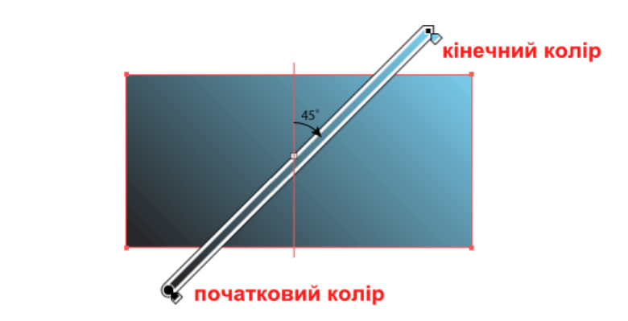
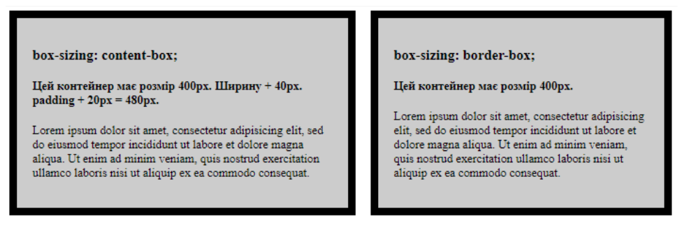
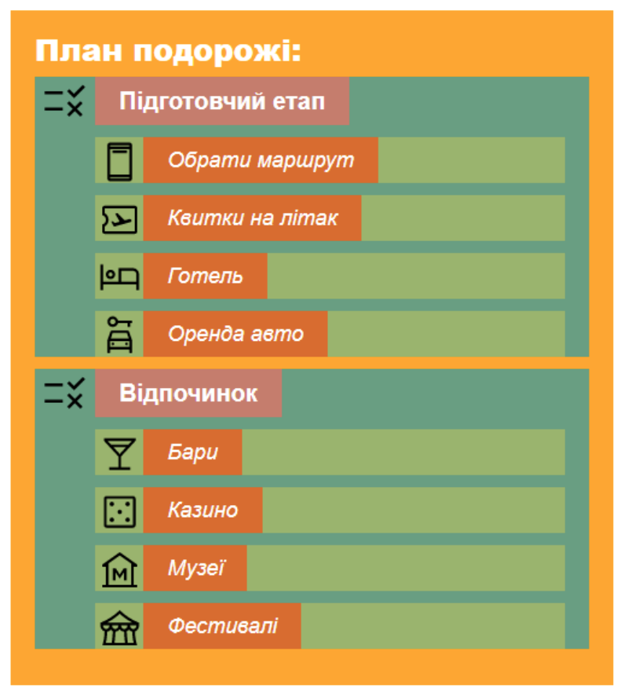
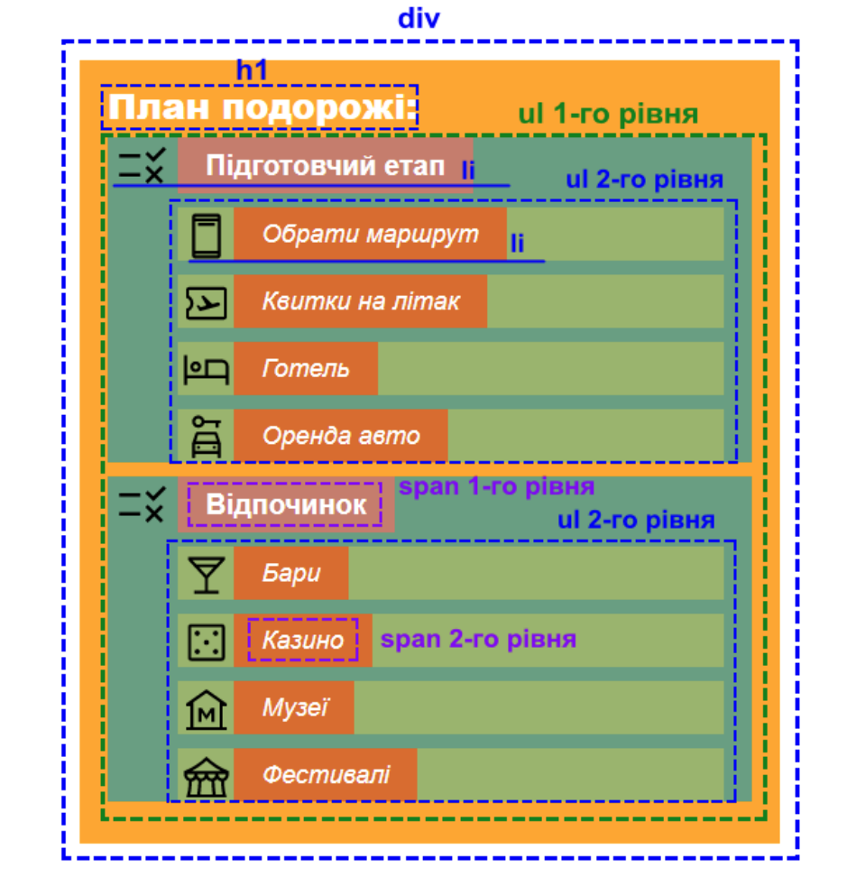
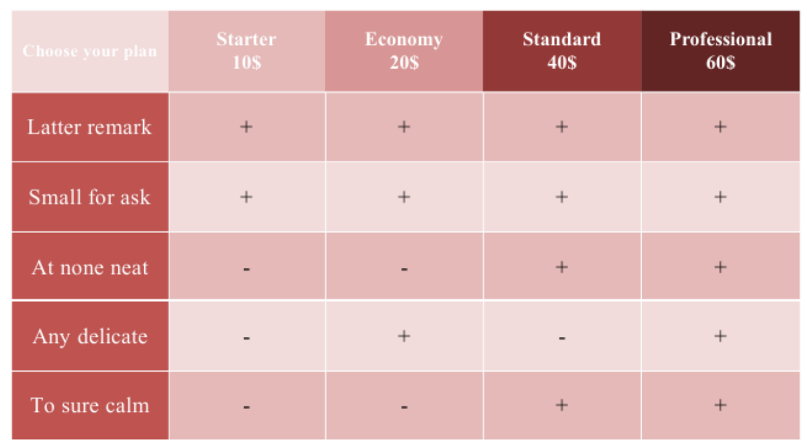

= Лабораторна робота №5

*Тема: CSS властивості блоків та фону (padding, margin, display, background)*

*Мета:* вивчити CSS-властивості блокової моделі та фону елементів; навчитися задавати внутрішні й зовнішні відступи, керувати типом відображення елементів та їхніми розмірами; навчитися створювати фон за допомогою кольору, зображень, лінійних і радіальних градієнтів, налаштовувати його повторення, положення, прокручування та масштабування; закріпити навички оформлення списків, таблиць і форм засобами CSS.

*Вимоги до звіту:* результати завдань лабораторної роботи повинні бути завантажені до особистого репозиторію студента.

== Теоретичний матеріал

Перелік основних CSS-властивостей:

=== padding – поля

Встановлює значення полів (внутрішні відступи) навколо вмісту (контенту) елемента.
Полем називається відстань від внутрішнього краю рамки елемента до уявного прямокутника, що обмежує його вміст.
Застосовується до блокових та блоково-рядкових об'єктів, але рекомендовано поєднувати тільки із блочними тегами.
У властивості `padding` не може бути від'ємних значень.

.Синтаксис
[source,css]
----
.example-block {
    padding: 20px 30px 40px 10px;
}
----

Параметри `padding` задаються за годинниковою стрілкою, починаючи із 12 год. (верх, право, низ, ліво).

* 1-й параметр – відступ від верхньої межі блоку
* 2-й параметр – відступ від правої межі блоку
* 3-й параметр – відступ від нижньої межі блоку
* 4-й параметр – відступ від лівої межі блоку

Різновиди `padding`:

* `padding-bottom` – встановлює значення поля від нижнього краю вмісту елемента.
* `padding-left` – встановлює значення поля від лівого краю вмісту елемента.
* `padding-right` – встановлює значення поля від правого краю вмісту елемента.
* `padding-top` – задає величину поля від верхнього краю вмісту елемента.

==== Варіанти запису padding

* Найчастіший запис, коли задають всі 4 параметри:
+
[source,css]
----
padding: 20px 30px 40px 10px;
----

* Запис із 3-х параметрів:
+
[source,css]
----
padding: 20px 30px 40px;
----
+
--
. відступ від верхньої межі блоку;
. відступ від правої та лівої меж блоку;
. відступ від нижньої межі блоку.
--

* Запис із 2-х параметрів:
+
[source,css]
----
padding: 20px 30px;
----
+
--
. відступ від верхньої та нижньої меж блоку;
. відступ від правої та лівої меж блоку.
--

* Запис із 1-м параметром, який буде застосовний для всіх сторін:
+
[source,css]
----
padding: 20px;
----

Також значення `padding` можна задавати не тільки в пікселях, але й у відсотках та інших числових значеннях.

=== margin – відступи

Встановлює величину зовнішнього відступу від кожного краю елемента до навколишніх об'єктів.
Відступом є простір від кордону поточного елемента до внутрішньої межі його батьківського елемента.
Застосовується до блокових та блоково-рядкових об'єктів.

.Синтаксис
[source,css]
----
.example-block {
    margin: 25px 30px 15px 45px;
}
----

* 1-й параметр – відступ від верхньої межі блоку
* 2-й параметр – відступ від правої межі блоку
* 3-й параметр – відступ від нижньої межі блоку
* 4-й параметр – відступ від лівої межі блоку

Різновиди `margin`:

* `margin-bottom` – встановлює відступ від нижнього краю елемента.
* `margin-left` – встановлює відступ від лівого краю елемента.
* `margin-right` – встановлює відступ від правого краю елемента.
* `margin-top` – встановлює відступ від верхнього краю елемента.

Властивість `margin` має ті ж варіанти запису, що й `padding`: 4, 3, 2 або 1 параметр.

=== background – колір та фон

Параметр дозволяє встановити одночасно декілька характеристик фону, а саме:

* визначити колір фону;
* встановити фонове зображення;
* встановити початкове положення фонового зображення;
* визначити, як повторюватиметься фонове зображення;
* встановити, чи прокручуватиметься фонове зображення разом із вмістом;
* встановити, чи масштабувати фонове зображення відповідно до заданих розмірів.

Значення можуть йти в будь-якому порядку, браузер сам визначить, яке з них відповідає потрібному атрибуту.
Також значенням CSS-властивості `background` може бути вказана градієнтна заливка фону.

==== Характеристики властивості background

===== background-color

Встановлює фоновий колір елемента.

===== background-image

Встановлює фонове зображення для елемента або задає градієнтну заливку.
Якщо одночасно для елемента заданий колір фону, він буде показаний, поки фонова картинка не завантажиться повністю.

====== Використання картинки

[source,css]
----
.block {
    background: url('../img/image_7_1.jpg');
}

/* АБО */

.block {
    background-image: url('../img/image_7_1.jpg');
}
----

NOTE: Не рекомендують використовувати одну або декілька картинок із великим розміром, тому що чим більший розмір картинки, тим більша її «вага», тобто розмірність файлу.
А для верстки важлива швидкість завантаження: чим менша розмірність файлу, тим швидше він завантажується.
Тому рекомендують дотримуватись наступного: у випадках, коли можливо вирізати частину картинки, потім повторювати її по вертикалі і по горизонталі *n*-ну кількість разів, щоби вона заповнила весь необхідний простір, оскільки «вага» сторінки при цьому буде набагато меншою.

====== Використання градієнтної заливки

Градієнтом називають плавний перехід від одного кольору до іншого, причому самих кольорів та переходів між ними може бути декілька.
За допомогою градієнтів створюються найхимерніші ефекти веб-дизайну, наприклад, псевдотривимірність, відблиски, фон тощо.

Властивість `background-image` може підключати лінійний та радіальний градієнт.

Градієнтна заливка підтримується браузерами не повністю, тому для цього використовуються спеціальні записи під кожен вид браузера.

[source,css]
----
/* Old browsers */
background: rgb(236, 232, 157);

/* FF3.6-15 */
background: -moz-linear-gradient(top, rgba(236, 232, 157, 1) 0%, rgba(94, 83, 115, 1) 50%, rgba(24, 181, 164, 1) 100%);

/* Chrome10-25, Safari5.1-6 */
background: -webkit-linear-gradient(top, rgba(236, 232, 157, 1) 0%, rgba(94, 83, 115, 1) 50%, rgba(24, 181, 164, 1) 100%);

/* W3C, IE10+, FF16+, Chrome26+, Opera12+, Safari7+ */
background: linear-gradient(to bottom, rgba(236, 232, 157, 1) 0%, rgba(94, 83, 115, 1) 50%, rgba(24, 181, 164, 1) 100%);
----

*Лінійний градієнт*

Розглянемо синтаксис задання лінійного градієнта на базі двох кольорів.
У найпростішому випадку з двома кольорами спочатку пишеться позиція, від якої буде починатися градієнт, потім початковий і кінцевий колір.

[source,css]
----
/*
1-й параметр to top right - позиція
2-й параметр #000 - початковий колір
3-й параметр #fff - кінцевий колір
*/
background: linear-gradient(to top right, #000, #fff);
----

Для запису позиції спочатку пишеться `to`, потім додаються ключові слова `top`, `bottom`, `left`, `right` і навіть їх поєднання.
Порядок слів не є важливим, можна написати `to left top` або `to top left`.
У табл. 1 наведено різні позиції і тип градієнта для кольорів `#000` і `#fff` (від чорного до білого).

.Таблиця 1
[cols="2,4,2",options="header"]
|===
|Позиція |Опис |Кут

|`to top`
|Знизу догори
|`0deg`

|`to left`
|Справа наліво
|`270deg`

|`to bottom`
|Зверху донизу
|`180deg`

|`to right`
|Зліва направо
|`90deg`

|`to top left`
|Від правого нижнього кута до лівого верхнього.
|залежить від розмірів елемента

|`to top right`
|Від лівого нижнього кута до правого верхнього.
|залежить від розмірів елемента

|`to bottom left`
|Від правого верхнього кута до лівого нижнього.
|залежить від розмірів елемента

|`to bottom right`
|Від лівого верхнього кута до правого нижнього.
|залежить від розмірів елемента
|===

.Приклад
[source,css]
----
.block {
    background-image: linear-gradient(to left top, white, black);
    height: 400px;
    color: red;
}
----

Замість ключового слова допускається задавати кут нахилу градієнтної лінії, який показує напрямок градієнта.
Спочатку пишеться позитивне чи негативне значення кута, потім до нього разом додається `deg`.

[source,css]
----
/*
1-й параметр 45deg - кут нахилу
2-й параметр #000 - початковий колір
3-й параметр #fff - кінцевий колір
*/
background: linear-gradient(-45deg, #000, #fff);
----

[source,css]
----
.block {
    background-image: linear-gradient(-45deg, white, black);
    height: 400px;
    color: red;
}
----

Нулю градусів (або 360°) відповідає градієнт знизу вгору, далі відлік ведеться за годинниковою стрілкою.
Відлік кута нахилу градієнтної лінії показано нижче.

Для значення `top left` і подібних до нього кут нахилу градієнтної лінії обчислюється, виходячи з розмірів елемента так, щоб з'єднувати дві діагонально протилежні кутові точки.

Для створення складних градієнтів двох кольорів буде недостатньо, тому синтаксис дозволяє додавати їх необмежену кількість, перераховуючи кольори через кому.
При цьому можна використовувати прозорий колір (ключове слово `transparent`) та напівпрозорий за допомогою формату RGBA.

[source,css]
----
.block {
    background-image:
        linear-gradient(
            to bottom,
            rgba(236, 232, 157, 1),
            rgba(94, 83, 115, 1),
            rgba(24, 181, 164, 1));

    height: 400px;
    color: red;
}
----

Щоб точно позиціонувати кольори у градієнті, після значення кольору може вказуватися його положення (відсоток займаного простору, або звідки відбудеться старт даного кольору) у відсотках, пікселях чи інших одиницях.
Наприклад, запис `Red 0%, Orange 50%, Yellow 100%` означає, що градієнт починається з червоного кольору, потім на 50% переходить в помаранчевий, а потім до кінця жовтий.
Для простоти крайні значення на кшталт 0% і 100% можна не писати, вони маються на увазі за замовчуванням.

[source,css]
----
.block {
    background-image:
        linear-gradient(
            to bottom,
            rgba(236, 232, 157, 1) 0%,
            rgba(94, 83, 115, 1) 60%,
            rgba(24, 181, 164, 1) 100%);

    height: 400px;
    color: red;
}
----

Градієнти досить популярні серед веб-дизайнерів, але їхнє додавання ускладнюється різними властивостями під кожен браузер і вказівкою множини кольорів.
Щоб вам було простіше створювати градієнти та вставляти їх у код, рекомендую інструмент, за допомогою якого легко налаштувати градієнти та одразу отримати потрібний код: https://www.colorzilla.com/gradient-editor/[ColorZilla Gradient Editor].

*Радіальний градієнт*

Радіальні градієнти за своїм принципом схожі на лінійні, але один колір переходить в інший не вздовж прямої лінії, а немов кола по воді навколо крапки.

Радіальний градієнт створюється за допомогою властивості `background` або `background-image` із параметром `radial-gradient`.
У найпростішому випадку для завдання радіального градієнта знадобиться лише два параметри: початковий та кінцевий колір.
За замовчуванням початкова точка розташована при цьому в центрі.

[source,css]
----
.block {
    background: radial-gradient(yellow, #0000FF);

    height: 400px;
    color: red;
}
----

Початкову точку градієнта можна задавати в будь-якому місці елемента, при цьому спочатку вказується її позиція.

[source,css]
----
/*
1-й параметр at top left - позиція
2-й параметр #000 - початковий колір
3-й параметр #fff - кінцевий колір
*/
background: radial-gradient(at top left, #000, #fff);
----

Позиція точки задається за допомогою ключових слів або доступних одиниць виміру на кшталт пікселів чи відсотків.
Нижче наведено можливі поєднання.

* `at top left` = `at left top` = `at 0% 0%` (у лівому верхньому куті);
* `at top` = `at top center` = `at center top` = `at 50% 0%` (по центру вгорі);
* `at right top` = `at top right` = `at 100% 0%` (у правому верхньому куті);
* `at left` = `at left center` = `at center left` = `at 0% 50%` (ліворуч і по центру);
* `at center` = `at center center` = `at 50% 50%` (по центру) – це значення за замовчуванням;
* `at right` = `at right center` = `at center right` = `at 100% 50%` (з правого краю та по центру);
* `at bottom left` = `at left bottom` = `at 0% 100%` (у лівому нижньому куті);
* `at bottom` = `at bottom center` = `at center bottom` = `at 50% 100%` (по центру внизу);
* `at bottom right` = `at right bottom` = `at 100% 100%` (у правому нижньому куті).

Можливі дві форми радіального градієнта – коло (`circle`) та еліпс (`ellipse`), які відрізняються своїм виглядом.
За замовчуванням встановлюється еліптичний градієнт.

[source,css]
----
/*
1-й параметр circle - тип градієнта
2-й параметр #000 - початковий колір
3-й параметр #fff - кінцевий колір
*/
background: radial-gradient(circle, #f9e497, #ffb60f);
----

У прикладі показано створення кругового градієнта із заданою початковою точкою.
Для посилення контрастності між кольорами використовується три значення кольору.

[source,css]
----
.block {
    background: radial-gradient(circle at 80px 40px, purple, green, yellow);

    height: 400px;
    color: red;
}
----

Зверніть увагу на синтаксис: якщо ми хочемо поєднувати форму градієнта із зазначенням початкової точки, то спочатку йде ключове слово `circle`/`ellipse`, а потім уже через пробіл позиція.

Поряд із типом градієнта можна задавати і його розмір, який залежить від ключових слів, що застосовуються.
Розмір пишеться через пробіл після типу градієнта (`circle` або `ellipse`).

[source,css]
----
/*
1-й параметр circle closest-side at center - тип розмір позиція
2-й параметр #000 - початковий колір
3-й параметр #fff - кінцевий колір
*/

background: radial-gradient(circle closest-side at center, #fff, #000);
----

У табл. 2 перераховані можливі значення розміру з їх описом.

.Таблиця 2
[cols="2,4",options="header"]
|===
|Значення |Опис

|`closest-side`
|Форма градієнта збігається із найближчою до нього стороною блоку.

|`closest-corner`
|Форма градієнта обчислюється виходячи з інформації про відстань до найближчого кута блоку.

|`farthest-side`
|Градієнт розповсюджується до дальньої сторони блоку.

|`farthest-corner`
|Форма градієнта обчислюється виходячи з інформації про відстань до дальнього кута блоку.
|===

.Код до таблиці 2
[source,css]
----
/* closest-side */
background: radial-gradient(circle closest-side at 30px 20px, #fff, #000);
background: radial-gradient(ellipse closest-side at 30px 20px, #fff, #000);

/* closest-corner */
background: radial-gradient(circle closest-corner at 30px 20px, #fff, #000);
background: radial-gradient(ellipse closest-corner at 30px 20px, #fff, #000);

/* farthest-side */
background: radial-gradient(circle farthest-side at 30px 20px, #fff, #000);
background: radial-gradient(ellipse farthest-side at 30px 20px, #fff, #000);

/* farthest-corner */
background: radial-gradient(circle farthest-corner at 30px 20px, #fff, #000);
background: radial-gradient(ellipse farthest-corner at 30px 20px, #fff, #000);
----

Для центральної початкової точки градієнти на кшталт `closest-corner` і `farthest-side` збігаються.
Але градієнти відрізнятимуться, якщо встановити початкову точку в куті.

[source,css]
----
.block {
    background: radial-gradient(ellipse farthest-side at 40px 30px, yellow, blue);

    height: 400px;
    color: red;
}
----

Подібно до лінійного градієнта можна вказувати декілька кольорів, встановлювати їх позицію і робити різкі переходи між кольорами.
Для цього довільна кількість кольорів перераховується через кому, а після значення кольору через пробіл йде його позиція, яка може бути задана в пікселях або відсотках.
Крайні значення 0% та 100% можна не писати, вони маються на увазі за замовчуванням.

[source,css]
----
/*
1-й параметр #fff 0% - колір позиція
2-й параметр #c30 50% - колір позиція
3-й параметр #6c0 90% - колір позиція
4-й параметр #000 100% - колір позиція
*/
background: radial-gradient(#fff 0%, #c30 50%, #6c0 90%, #000 100%);
----

[source,css]
----
.block {
    background:
        radial-gradient(
            ellipse at center,
            rgba(30, 87, 153, 1),
            rgba(41, 137, 216, 1) 50%,
            rgba(32, 124, 202, 1) 51%,
            rgba(125, 185, 130, 1));

    height: 400px;
    color: red;
}
----

Якщо лінійний і радіальний градієнт доповнити властивістю `background-size`, тоді ми отримаємо найрізноманітніші фонові картинки, що повторюються, які зроблені без використання зображень.

===== background-repeat

Визначає, як буде повторюватися фонове зображення, встановлене за допомогою параметра `background-image`, і по якій осі.
Можна встановити повторення зображення тільки по горизонталі, по вертикалі або в обидві сторони.

Може приймати значення:

* `no-repeat` – встановлює одне фонове зображення в елементі без його повторень, положення якого визначається атрибутом `background-position` (за замовчуванням в лівому верхньому куті);
* `repeat` – фонове зображення повторюється по горизонталі і вертикалі;
* `repeat-x` – фонове зображення повторюється тільки по горизонталі;
* `repeat-y` – фонове зображення повторюється тільки по вертикалі;
* `space` – фонове зображення повторюється стільки разів, щоб повністю заповнити область; якщо це не вдається, між картинками додається порожній простір;
* `round` – фонове зображення повторюється так, щоб в області помістилося ціле число рисунків; якщо це не вдається зробити, фонові рисунки масштабуються (обрізуються, стискаються тощо).

[source,css]
----
.block {
    background: url('../img/image_7_1.jpg') no-repeat;

    /* АБО */

    background-image: url('../img/image_7_1.jpg');
    background-repeat: no-repeat;

    height: 400px;
}
----

===== background-position

Задає початкове положення фонового зображення, встановленого за допомогою властивості `background` або `background-image`.

Може приймати значення:

* за замовчуванням (верхній лівий кут): `0 0` або `top left`;
* по центру: `50%` або `50% 50%` або `center`;
* зліва: `0% 50%` або `left`;
* справа: `100% 50%` або `right`;
* правий нижній кут: `100% 100%` або `bottom right`;
* задана позиція: `значення_1 значення_2`.

[source,css]
----
.block {
    background: url('../img/image_7.jpg') 0 0 no-repeat;
    /* АБО */
    background: url('../img/image_7.jpg') top left no-repeat;

    /* АБО */

    background-image: url('../img/image_7.jpg');
    background-repeat: no-repeat;
    background-position: 0 0;
    /* АБО */
    background-position: top left;

    height: 600px;
}
----

===== background-attachment

Параметр `background-attachment` встановлює, чи буде прокручуватися фонове зображення разом з вмістом елемента.
Зображення може бути зафіксовано і залишатися нерухомим, або переміщатися разом з документом.

Може приймати значення:

* `scroll` – дозволяє переміщатися фону разом із вмістом;
* `fixed` – робить фонове зображення елемента нерухомим.
Тобто фонове зображення елемента стає фіксованим відносно не свого блоку, якому воно було призначено, а відносно всієї HTML-сторінки (відносно тегу `body`);
* `local` – фон фіксується з урахуванням поведінки елемента.
Якщо елемент має прокручування, то фон прокручуватиметься разом із вмістом, але фон, що виходить за рамки елемента, залишається на місці.

[source,css]
----
.block {
    background: url('../img/image_7.jpg') 0 0 no-repeat scroll;

    /* АБО */

    background-image: url('../img/image_7.jpg');
    background-repeat: no-repeat;
    background-attachment: scroll;

    max-height: 300px;
}
----

===== background-size

Масштабує фонове зображення згідно з заданими розмірами.

Роздільна здатність моніторів постійно зростає, і при верстці веб-сторінок доводиться враховувати найширший діапазон розширень.
Це особливо важливо при використанні фонового зображення, яке або обрізується при низькій роздільній здатності монітора, або, навпаки, повністю не вміщується при високій.
Одним із рішень подібної ситуації є масштабування фону.
Звичайно, це обіцяє деякі неприємності на кшталт появи спотворень та артефактів у зображеннях, але й розширює арсенал засобів верстки.

Може приймати наступні значення:

* конкретні розміри – якщо встановлено одне значення, то воно визначає ширину фону, друге значення приймається за `auto`.
Пропорції картинки при цьому зберігаються.
Використання двох значень через пробіл задає ширину і висоту фонової картинки:
** `<значення>` – задає розмір у будь-яких доступних для CSS одиницях;
** `<відсотки>` – задає розмір фонової картинки у відсотках від ширини чи висоти елемента;
** `auto` – якщо встановлено одночасно для ширини і висоти (`auto auto`), розміри фону залишаються вихідними; якщо для однієї сторони картинки (`100px auto`), то розмір обчислюється автоматично з пропорцій картинки;
* ключове слово `contain` – масштабує зображення зі збереженням пропорцій таким чином, щоб картинка повністю помістилася всередину блоку, за розміром меншої сторони картинки;
* ключове слово `cover` – масштабує зображення зі збереженням пропорцій так, щоб його ширина або висота дорівнювала ширині або висоті блоку, за розміром більшої сторони картинки.

Розглянемо приклади, на яких продемонструємо зміну розмірів зображень за різних значень `background-size`.

* Розміри картинки по ширині блоку:
+
[source,css]
----
.block {
    background: url('../img/image_7_1.jpg') 0 0/100% auto no-repeat;

    /* АБО */

    background-image: url('../img/image_7.jpg');
    background-position: 0 0;
    background-repeat: no-repeat;
    background-size: 100% auto;
}
----

* Розміри картинки по висоті блоку:
+
[source,css]
----
.block {
    background: url('../img/image_7_1.jpg') 0 0/auto 100% no-repeat;

    /* АБО */

    background-image: url('../img/image_7.jpg');
    background-position: 0 0;
    background-repeat: no-repeat;
    background-size: auto 100%;
}
----

* Розтягуємо картинку на всю ширину та висоту блоку:
+
[source,css]
----
.block {
    background: url('../img/image_7_1.jpg') 0 0/100% 100% no-repeat;

    /* АБО */

    background-image: url('../img/image_7.jpg');
    background-position: 0 0;
    background-repeat: no-repeat;
    background-size: 100% 100%;
}
----

* Розміри картинки по фіксованих розмірах:
+
[source,css]
----
.block {
    background: url('../img/image_7_1.jpg') 0 0/250px 150px no-repeat;

    /* АБО */

    background-image: url('../img/image_7.jpg');
    background-position: 0 0;
    background-repeat: no-repeat;
    background-size: 250px 150px;
}
----

* Ключове слово `contain`:
+
[source,css]
----
.block {
    background: url('../img/image_7_1.jpg') 0 0/contain no-repeat;

    /* АБО */

    background-image: url('../img/image_7.jpg');
    background-position: 0 0;
    background-repeat: no-repeat;
    background-size: contain;
}
----

* Ключове слово `cover`:
+
[source,css]
----
.block {
    background: url('../img/image_7_1.jpg') 0 0/cover no-repeat;

    /* АБО */

    background-image: url('../img/image_7.jpg');
    background-position: 0 0;
    background-repeat: no-repeat;
    background-size: cover;
}
----

Поки що смисл його використання не зрозумілий.
Однак, якщо змінити позицію розташування картинки на центр (`50%` або `center`), а далі змінювати розміри браузера, то ми побачимо, що в залежності від ширини браузера наша картинка буде постійно старатись вписатись у блок, при цьому постійно масштабуючись.
Те саме відбудеться, коли ми будемо змінювати висоту нашого блоку.
Картинка старається «влізти» в блок.

До фону відноситься також градієнт, який також можна масштабувати, тим самим отримуючи різні ефекти.
Наприклад, додавши `background-size` до лінійного градієнта, ми змусимо його повторюватися, що утворює градієнтні смужки, які чергуються.

[source,css]
----
.block {
    background: linear-gradient(to right, #f8ffe8, #e3f5ab 33%, #b7df2d);
    background-size: 30px 30px;
}
----

Вертикальні та горизонтальні смуги можна робити не тільки градієнтними, але і з точними краями.
Для цього в параметрах градієнта треба вказати чотири кольори – від 0 до 50% колір першої смуги і від 50% до 100% колір другої смуги.
Перший колір з 0% і останній колір зі 100% можна не писати, вони додаються браузером автоматично, тому обмежимося лише двома значеннями.

У прикладі показано створення горизонтальних смуг заввишки 50 пікселів.

[source,css]
----
.block {
    background: linear-gradient(#33bbf1 50%, #00aaee 50%);
    background-size: 50px 50px;
}
----

Оскільки можна одночасно додавати декілька фонів, перераховуючи їх параметри через кому, те саме можна проробити і з градієнтами.
Тільки один із кольорів має бути напівпрозорим, інакше градієнти перекриватимуть один одного.
У наступному прикладі для фону веб-сторінки застосовуються два градієнти, що перетинаються під прямим кутом, що у поєднанні з `background-size` створює клітинки.

[source,css]
----
.block {
    background: linear-gradient(transparent 50%, rgba(0, 186, 0, 0.2) 50%),
                linear-gradient(90deg, rgba(0, 186, 0, 0.2) 50%, transparent 50%);
    background-size: 40px 40px;
}
----

Поєднання градієнта та властивості `background-size` дозволяє отримати найрізноманітніші види фонових заливок, створених без застосування фонових зображень.

====== Встановлення декількох фонових зображень для блоку

Властивість `background` дозволяє задати декілька фонових зображень одному блоку, причому зі своїми налаштуваннями позиціонування, масштабування та прокручування.
Вказувати значення слід через кому.

* Одна картинка + колір блоку:
+
[source,css]
----
.block {
    background: yellow url(../img/image_7_1.jpg) no-repeat;

    /* АБО */

    background-color: yellow;
    background-image: url(../img/image_7_1.jpg);
    background-repeat: no-repeat;
}
----

* Дві картинки, у кожної свої налаштування, при цьому кожна наступна розташовується під попередньою:
+
[source,css]
----
.block {
    background: url('../img/image_7.jpg') left no-repeat,
                url('../img/image_16.jpg') 50%/cover no-repeat;

    /* АБО */

    background-image: url(../img/image_7.jpg), url(../img/image_16.jpg);
    background-repeat: no-repeat;
    background-position: left, 50%;
    background-size: auto auto, cover;
}
----

* Три картинки, у кожної свої налаштування, при цьому кожна наступна розташовується під попередньою:
+
[source,css]
----
.block {
    background: url('../img/image_14.png') bottom right/175px no-repeat,
                url('../img/image_7.jpg') left no-repeat,
                url('../img/image_16.jpg') 50%/cover no-repeat;

    /* АБО */

    background-image: url('../img/image_14.png'),
                      url('../img/image_7.jpg'),
                      url('../img/image_16.jpg');
    background-repeat: no-repeat;
    background-position: bottom right, left, 50%;
    background-size: 175px, auto auto, cover;
}
----

=== Форматування

==== width

Встановлює ширину блокових елементів.
Ширина не включає товщину кордонів навколо елемента, значення відступів і полів.

При встановленні статичної ширини блоку, при зміні розмірів екрану, в даного блоку ширина не змінюватиметься.

==== max-width

Встановлює максимальну ширину блокових елементів.
Іншими словами, дана властивість – це обмежувач ширини елемента.

==== min-width

Задає мінімальну ширину елемента.
Якщо вікно браузера досягає заданої мінімальної ширини елемента, то його ширина залишається незмінною і з'являється горизонтальна смуга прокрутки.

==== height

Встановлює висоту блокових елементів.
Висота не включає товщину кордонів навколо елемента, значення відступів і полів.

==== max-height

Встановлює максимальну висоту елемента.
Значення висоти елемента буде обчислюватися залежно від встановлених параметрів `height`, `max-height` і `min-height`.

==== min-height

Задає мінімальну висоту елемента.
Значення висоти елемента буде обчислюватися залежно від встановлених параметрів `height`, `max-height` і `min-height`.

==== box-sizing

Застосовується для зміни алгоритму розрахунку ширини та висоти елемента.

Згідно зі специфікацією CSS ширина блоку (елемента) складається із ширини вмістимого контенту (`width`), значень `margin`, `padding` та `border`.
Аналогічно і з висотою блоку.

Проте, коли ви вказуєте ширину блоку (`width`), браузер розраховує її без врахування меж (`border`) та внутрішніх відступів (`padding`).

Тому властивість `box-sizing` дозволяє змінити цей алгоритм, щоб властивості `width` і `height` задавали розміри не вмістимого контенту, а саме розмір блоку.

Значення властивості `box-sizing`:

* `content-box` – ґрунтується на стандартах CSS, при цьому властивості `width` і `height` задають ширину і висоту контенту і не включають в себе значення відступів, полів і кордонів;
* `border-box` – властивості `width` і `height` включають в себе значення полів і кордонів, але не відступів (`margin`).

За замовчуванням використовується значення `content-box`, а це означає, що будь-які розміри, які ви задаєте, використовуються лише для визначення розміру вмістимого контенту – будь-які поля (`padding`) і межі (`border`) виводяться за межі вмістимого контенту.

Тому, застосовуючи ширину 200 пікселів та `padding` 10 пікселів до елемента, елемент буде займати загальну ширину 220 пікселів (припускаючи, що `padding` додається до всіх чотирьох сторін або, принаймні, з лівого та правого боку).

Вказавши `border-box` у якості значення властивості `box-sizing`, браузер почне враховувати кордони та відступи у формуванні ширини та висоти блоку.
У цьому випадку елемент буде займати лише 200 пікселів, тому що заповнення додано до внутрішньої частини елемента.

Ця властивість особливо важлива для створення адаптивного дизайну.

==== overflow

Властивість `overflow` управляє відображенням змісту блокового елемента, якщо воно цілком не поміщається і виходить за область заданих розмірів.

Дану властивість поєднують із попередніми властивостями.

Може приймати значення:

* `overflow: visible;`
+
Візуально з блоком нічого не буде.
Але якщо ми обмежимо даний блок по висоті, то ми побачимо, що текст виходить за межі блоку та текст є видимим.
+
[source,css]
----
.example-block {
    overflow: visible;
    max-height: 50px;
    border: 2px solid black;
}
----

* `overflow: hidden;`
+
Дане значення приховує все, що знаходиться за межами блоку.
+
[source,css]
----
.example-block {
    overflow: hidden;
    max-height: 50px;
    border: 2px solid black;
}
----

* `overflow: scroll;`
+
Дане значення додає смуги прокрутки (горизонтальну та вертикальну) до блоку в обов'язковому порядку, незалежно від того, чи обидві вони потрібні.
+
[source,css]
----
.example-block {
    overflow: scroll;
    max-height: 50px;
    border: 2px solid black;
}
----

* `overflow: auto;`
+
Дане значення додає смуги прокрутки (горизонтальну та вертикальну) до блоку тільки тоді, коли вони необхідні.
Тут може бути додано одну смугу прокрутки (або горизонтальну, або вертикальну) або дві.
+
[source,css]
----
.example-block {
    overflow: auto;
    max-height: 50px;
    border: 2px solid black;
}
----

==== display

Багатофункціональна властивість, яка визначає, як елемент повинен бути відображений в документі.

Може приймати значення:

* `display: block;` (застосовують до рядкових елементів)
+
Даний параметр змушує елемент відображатись як блок: тег починає займати всю ширину простору, на нього починають діяти властивості `width`, `height`, `max-(width, height)`, `min-(width, height)` тощо, а також верхні та нижні відступи (як зовнішні, так і внутрішні).
Тобто елемент, фактично, із рядкового перетворюється у блочний.

* `display: inline;` (застосовують до блокових елементів)
+
Даний параметр змушує елемент відображатись як рядковий: тег починає займати ширину, рівну тільки ширині контенту, і вибудовується в рядок; на нього перестають діяти властивості `width`, `height`, `max-(width, height)`, `min-(width, height)` тощо, а також верхні та нижні відступи (як зовнішні, так і внутрішні).

* `display: inline-block;`
+
Елемент залишається рядковим, тобто займає ширину, рівну тільки ширині контенту, вибудовується в рядок, проте на нього починають діяти властивості `width`, `height`, `max-(width, height)`, `min-(width, height)` тощо, а також верхні та нижні відступи (як зовнішні, так і внутрішні).

* `display: none;`
+
Тимчасово видаляє елемент із документа, займане ним місце не резервується, а веб-сторінка формується так, ніби цього елемента немає.

== Практична частина

=== Завдання 1

Створити HTML-файл `lab4_1.html` та таблицю стилів `style.css`.
У файлі `lab4_1.html` підключити файл `style.css`.

Реалізувати з використанням CSS-стилів дворівневий список за вказаним зразком.
Іконки знаходяться в директорії `icons` (на замітку: іконки від Google – https://fonts.google.com/icons).

.Умови стилів
[cols="2,5",options="header"]
|===
|Елемент |Властивості

|`div`
a|
* колір фону – `rgb(255, 165, 0)`;
* ширина блоку – `500px`;
* внутрішній відступ – з усіх сторін `20px`;
* колір тексту – білий.

|Заголовок 1-го рівня (`h1`)
a|
* розмір тексту – `25px`;
* насиченість шрифту (вага шрифту) – `900` (black);
* зовнішній відступ – нижній `10px`.

|Маркерований список (загальні вимоги)
a|
* розташовувати маркер всередині вмісту списку;
* як маркер елементів списку використати зображення, для цього використати CSS-властивості: `background-image`, `background-position`, `background-repeat`, `background-size`.

|Маркерований список 1-го рівня
a|
* колір фону – `rgb(103, 158, 128)`;
* внутрішній відступ – правий `20px`, лівий `50px`.

|Маркерований список 2-го рівня
a|
* розмір тексту – `18px`;
* зображення шрифту – курсив;
* колір фону – `rgb(153, 180, 102)`;
* зовнішній відступ – нижній (від кожного елемента списку) `10px`;
* внутрішній відступ – лівий (від найменування списку до його позначення) `40px`.

|Елемент `span`
a|
* внутрішній відступ – верхній та нижній `10px`, лівий та правий `20px`;
* тип блоку – рядково-блочний (`display: inline-block`).

|Елемент `span` в маркерованому списку 1-го рівня
a|
* розмір тексту – `20px`;
* насиченість шрифту (вага шрифту) – `700` (bold);
* колір фону – `rgb(199, 124, 106)`;
* зовнішній відступ – нижній `10px`.

|Елемент `span` в маркерованому списку 2-го рівня
a|
* колір фону – `rgb(218, 106, 32)`.
|===

Результат

Структура

=== Завдання 2

Створити HTML-файл `lab4_2.html` та таблицю стилів `style.css`.
У файлі `lab4_2.html` підключити файл `style.css`.

Реалізувати з використанням CSS-стилів таблицю за вказаним зразком.
Текстове наповнення та набір кольорів на вибір студента, проте однієї колірної гамми (від найсвітлішого до найтемнішого).
Додавання нового рядка не порушує стилі таблиці.

CAUTION: *Забороняється* використовувати селектори класів та ідентифікаторів.

=== Завдання 3

Створити HTML-файл `lab4_3.html` та таблицю стилів `style.css`.
У файлі `lab4_3.html` підключити файл `style.css`.

Розробити дизайн форми анкети, реалізованої в лабораторній роботі №3 (questionnaire.html, через CSS-властивості шрифту, тексту та кольору фону.
Значення CSS-властивостей на вибір студента.

=== Завдання 4

Створити HTML-файл `lab4_4.html` та таблицю стилів `style.css`.
У файлі `lab4_4.html` підключити файл `style.css`.

Реалізувати *без використання зображень* чотири блоки з різними фонами, створеними лише за допомогою градієнтів та властивості `background-size`.
Усі блоки мають розмір `300px × 200px`, між блоками – зовнішній відступ `20px`, всередині кожного блоку – підпис з номером блоку та внутрішній відступ `15px`.
Блоки розташувати в ряд (`display: inline-block`).
Кольори на вибір студента, проте однієї колірної гамми.

.Умови завдання
[cols="1,5",options="header"]
|===
|Блок |Вимоги

|1
a|
* діагональні смуги двох відтінків одного кольору;
* лінійний градієнт під кутом `45deg` із чіткими межами (позиції кольорів `50%`);
* `background-size: 40px 40px`.

|2
a|
* фон у вигляді клітинок;
* два лінійних градієнти, що перетинаються під прямим кутом, один із кольорів – напівпрозорий (`rgba`);
* `background-size` – на вибір студента.

|3
a|
* радіальний градієнт форми `circle` із початковою точкою `30px 20px`;
* не менше трьох кольорів із явно заданими позиціями (у відсотках);
* розмір градієнта – `farthest-corner`.

|4
a|
* два фони одночасно: градієнт (напівпрозорий) поверх суцільного кольору блоку;
* градієнт не повторюється (`no-repeat`) та займає всю ширину блоку, а по висоті – `50%` (`background-size`);
* градієнт притиснутий до нижнього краю блоку (`background-position`).
|===

.Приклад заготовки для блоку 4
[source,css]
----
div:nth-of-type(4) {
    background-color: #33bbf1;
    background-image: linear-gradient(to top, rgba(0, 0, 0, 0.5), transparent);
    background-repeat: no-repeat;
    background-position: bottom;
    background-size: 100% 50%;
}
----

=== Завдання 5

Створити HTML-файл `lab4_5.html` та таблицю стилів `style.css`.
У файлі `lab4_5.html` підключити файл `style.css`.

Реалізувати сторінку, що демонструє роботу властивостей `box-sizing`, `overflow` та `display` за вказаним описом.

.Умови завдання
[cols="1,5",options="header"]
|===
|Частина |Вимоги

|1. `box-sizing`
a|
* два блоки `div` з однаковими `width: 300px`, `padding: 20px` та `border: 5px solid`;
* у першого блоку `box-sizing: content-box`, у другого – `box-sizing: border-box`;
* блоки розташувати в ряд (`display: inline-block`) із зовнішнім відступом `20px`;
* у кожному блоці вказати текстом, яку загальну ширину займає блок (розрахувати самостійно);
* колір фону та рамки – на вибір студента.

|2. `overflow`
a|
* чотири блоки `div` із однаковим довгим текстом, `max-height: 80px` та рамкою `2px solid`;
* для блоків використати значення `overflow`: `visible`, `hidden`, `scroll`, `auto` відповідно;
* у кожному блоці перед текстом вказати значення `overflow`, що використовується.

|3. `display`
a|
* горизонтальне меню з п'яти пунктів списку `ul > li > a`, без використання `float` та `flex`;
* елементи `li` – `display: inline-block`, елементи `a` – `display: block` із внутрішніми відступами `10px 20px`;
* маркери списку приховати;
* один із пунктів меню приховати за допомогою `display: none` та пояснити в коментарі до CSS, чим це відрізняється від приховування елемента іншими способами.
|===

.Приклад заготовки для частини 1
[source,css]
----
div:nth-of-type(1) {
    box-sizing: content-box;
    /* Загальна ширина: 300 + 2 * 20 + 2 * 5 = 350px */
}

div:nth-of-type(2) {
    box-sizing: border-box;
    /* Загальна ширина: 300px */
}
----

=== Завдання 6

Створити HTML-файл `lab4_6.html` та таблицю стилів `style.css`.
У файлі `lab4_6.html` підключити файл `style.css`.

Реалізувати односторінковий сайт-візитівку з фоновими зображеннями за вказаним описом.
Зображення на вибір студента (каталог `img`), стилі лише у зовнішньому файлі `style.css` (атрибут `style` у HTML заборонений).
Класи та ідентифікатори дозволені.

.Умови завдання
[cols="2,5",options="header"]
|===
|Частина |Вимоги

|Фон сторінки (`body`)
a|
* фонове зображення на всю сторінку: `background-size: cover`, `background-position: center`, `no-repeat`;
* зображення залишається нерухомим під час прокручування сторінки (`background-attachment: fixed`);
* запасний колір фону (`background-color`), який відображається, поки зображення завантажується.

|Контейнер (`main`)
a|
* `max-width: 900px`, `min-width: 320px`, розташований по центру сторінки;
* внутрішній відступ `20px`, `box-sizing: border-box`;
* напівпрозорий фон (`rgba`), щоб було видно фонове зображення сторінки;
* у коментарі до CSS пояснити, що відбувається з контейнером, коли вікно браузера вужче за `320px`.

|Блок «Теги» (`display`)
a|
* п'ять елементів `div`, які перетворені на рядкові (`display: inline`) і виводяться в один рядок;
* кожному з них задати `width: 200px` та `height: 100px`; у коментарі пояснити, чому ці значення не діють;
* під ними – п'ять елементів `span`, перетворених на блокові (`display: block`) із `width: 150px`; перевірити, що вони розташувались стовпцем і `width` діє.

|Блок «Повторення фону» (`background-repeat`)
a|
* чотири блоки висотою `200px` з однією й тією ж маленькою картинкою (наприклад, іконкою розміром `60px × 60px`) та різними значеннями `background-repeat`: `repeat-x`, `repeat-y`, `space`, `round`;
* кожен блок має підпис із назвою значення, що використовується;
* у коментарі до CSS описати різницю між `space` та `round`.

|Блок «Масштабування» (`background-size`)
a|
* два блоки з однаковою картинкою, однаковими розмірами (`300px × 200px`) та рамкою `2px solid`;
* у першого блоку `background-size: contain`, у другого – `cover`;
* для обох – `background-position: center` та `no-repeat`; підписати, який блок який.

|Блок «Прокручування фону» (`background-attachment`)
a|
* два блоки з однаковим довгим текстом, `max-height: 150px`, `overflow: auto` та однаковою фоновою картинкою;
* у першого – `background-attachment: scroll`, у другого – `background-attachment: local`;
* у коментарі пояснити, чим відрізняється поведінка фону під час прокручування вмісту всередині блоку.
|===

NOTE: Значення `auto` для `margin` (наприклад, `margin: 0 auto`) центрує по горизонталі блок із заданою або обмеженою шириною.
У теоретичній частині цієї роботи воно не розглядається, але потрібне для центрування контейнера.

.Приклад заготовки для фону сторінки та контейнера
[source,css]
----
body {
    background-color: #1b2a41;
    background-image: url('../img/image_16.jpg');
    background-repeat: no-repeat;
    background-position: center;
    background-size: cover;
    background-attachment: fixed;
}

.container {
    box-sizing: border-box;
    max-width: 900px;
    min-width: 320px;
    margin: 0 auto;
    padding: 20px;
    background-color: rgba(255, 255, 255, 0.85);
}
----

== Контрольні запитання

. Що таке `padding` і чим він відрізняється від `margin`?
До яких типів елементів вони застосовуються?
. У якому порядку задаються значення `padding` та `margin` у чотирьохпараметричному записі?
Як інтерпретується запис із трьох, двох і одного параметра?
. Чи можуть значення `padding` та `margin` бути від'ємними?
Поясніть відповідь для кожної властивості.
. Які характеристики фону можна задати за допомогою скороченого запису `background`?
Чи важливий порядок значень у ньому?
. Чим відрізняються `background-color` і `background-image`?
Що побачить користувач, якщо задати обидві властивості, а зображення ще не завантажилося?
. Чому не рекомендують використовувати великі фонові зображення?
Який підхід рекомендують замість них?
. Опишіть синтаксис лінійного градієнта.
Чим відрізняється запис `to top right` від запису з кутом у градусах?
Якому куту відповідає `to right`?
. Як задати градієнт із кількома кольорами та точним положенням кожного кольору?
Як отримати різкий перехід між кольорами без плавного розмиття?
. Чим відрізняється радіальний градієнт від лінійного?
Як задаються його форма (`circle` / `ellipse`), положення початкової точки та розмір (`closest-side`, `farthest-corner` тощо)?
. Які значення приймає `background-repeat`?
Чим відрізняються `space` і `round`?
. Для чого призначена `background-position`?
Як задати розташування зображення по центру та в правому нижньому куті двома способами?
. Чим відрізняються значення `scroll`, `fixed` і `local` властивості `background-attachment`?
. Поясніть різницю між `background-size: contain` і `background-size: cover`.
Що означає запис `100% auto`?
. Як працює `box-sizing`?
Яку загальну ширину займе блок із `width: 200px`, `padding: 10px` та `border: 5px solid` при `content-box` і при `border-box`?
Чому ця властивість важлива для адаптивного дизайну?
. Опишіть значення `display: block`, `inline`, `inline-block` і `none`.
Які властивості (`width`, `height`, вертикальні відступи) діють на елемент у кожному з цих випадків?
Чим відрізняється `overflow: scroll` від `overflow: auto`?
