= Лабораторна робота №6

*Тема:* CSS позиціонування.
CSS псевдокласи та псевдоелементи.

== Мета роботи

Вивчити CSS-властивості позиціонування елементів та керування їхньою видимістю (`position`, `top`, `right`, `bottom`, `left`, `z-index`, `opacity`, `visibility`), а також псевдокласи та псевдоелементи.
Набути практичних навичок створення багатошарових макетів, інтерактивних елементів (випадні меню, підказки, попапи) та оформлення форм засобами HTML і CSS без використання JavaScript.

== Теоретичний матеріал

Перелік основних CSS-властивостей:

=== opacity

Визначає рівень прозорості елемента веб-сторінки.
При частковій або повній прозорості через елемент проступає фоновий малюнок або інші елементи, розташовані нижче напівпрозорого об'єкта.

Приймає значення від `0` до `1`, де значення `0` - це повна прозорість елемента (він стає невидимим), `1` - повністю видимий елемент.

[source,css]
----
.example-block {
    opacity: 0;

    font-size: 30px;
}
----

Ми побачимо, що наш блок «зник», проте місце, яке він займав, залишилось.
Іншими словами, блок не забирається зі сторінки, а тільки стає прозорим, а займане ним місце залишається за блоком збереженим.

Це є основною відмінністю властивості `opacity: 0;` від властивості `display: none;`.

Властивість `opacity` застосовна до рядкових тегів.

=== visibility

Призначена для відображення або приховування елемента, включаючи рамку навколо нього і фон.
При приховуванні елемента, хоча він і стає непомітним, місце, яке елемент займає, залишається за ним.

Може приймати значення:

* `visible` - блок видимий, встановлюється за замовчуванням;
* `hidden` - блок не видимий.
** відмінність `visibility: hidden;` від `display: none;` в тому, що блок не забирається зі сторінки, а тільки ховається, тобто займане ним місце залишається;
** відмінність `visibility: hidden;` від `opacity: 0;` у тому, що блок ховається і взаємодіяти з ним не можна.

Властивість `visibility` застосовна до рядкових тегів.

=== position

Встановлює спосіб позиціонування елемента щодо вікна браузера чи інших об'єктів на веб-сторінці.

Властивість `position` використовують додатково із допоміжними властивостями `top`, `bottom`, `left` і `right`, які керують положенням елемента зверху, знизу, ліворуч і праворуч.
Іншими словами, вони дозволяють зсувати елемент як по горизонталі, так і по вертикалі відносно його початкового положення.

Значення задають пікселями, відсотками, можна використовувати від'ємні значення.

Поєднують із параметрами `position: relative`, `position: absolute`, `position: fixed` та `position: sticky` (тільки `top` або `bottom`).

Властивість `position` використовують додатково із допоміжною властивістю `z-index`, яка керує накладанням елементів один на одного по осі Z.
Кожен елемент може перебувати як нижче, так і вище за інші об'єкти веб-сторінки, їх розміщенням по Z-осі керує властивість `z-index`.
Ця властивість працює тільки для елементів, у яких значення `position` задано як `absolute`, `fixed` чи `relative`.
Значення `z-index` задають цілими числами, за замовчуванням значення дорівнює `0`.

Властивість `position` може приймати наступні значення:

==== static

Елементи відображаються як завжди.
Використання властивостей `left`, `top`, `right`, `bottom` і `z-index` не призводить до результатів.
Встановлюється за замовчуванням, тому його можна не задавати.

==== relative

Положення елемента встановлюється відносно його початкового положення в коді.
Додавання властивостей `left`, `top`, `right` та `bottom` змінює позицію елемента і зсуває його в той чи інший бік від початкового розташування.

Наприклад, для блоку-2 по горизонталі ми зробимо відступ від лівої межі, а по вертикалі - відступ від верхньої межі.
Для цього необхідно задавати значення властивостей `left` та `top`.

Одночасне використання `left` та `right`, або `top` та `bottom` позбавлене сенсу: у такому разі браузер надає перевагу `left` (а не `right`) та `top` (а не `bottom`).

[source,css]
----
.block-2 {
    background-color: aquamarine;
    position: relative;
    left: 50px;
    top: 60px;
}
----

*Приклад.* Є два блоки.
Додамо властивість `z-index` зі значенням `0` для блоку-2 та зі значенням `1` для блоку-3, тоді ми побачимо, що блок-3 перекриває блок-2, тобто блок-3 на даний момент буде важливішим.

[source,css]
----
.block-2 {
    background-color: aquamarine;
    position: relative;
    left: 50px;
    top: 60px;
    z-index: 0;
}

.block-3 {
    background-color: blueviolet;
    position: relative;
    z-index: 1;
}
----

Якщо вказати для блоку-2 властивість `z-index` зі значенням `2`, то відбудеться перекриття блоком-2 блоку-3, і вже блок-2 вважатиметься головним.

==== absolute

Елемент «нібито» вириваєтся з коду та «зависає» у повітрі.
Він перестає впливати на інші елементи.
Додавання властивостей `left`, `top`, `right` і `bottom` змінює позицію елемента та зсуває його в ту чи іншу сторону відносно елемента-батька, у якого заданий параметр `position: relative`.

*Приклад.* Для блоку-2 задаємо дану властивість.

[source,css]
----
.block-1 {
    background-color: darkkhaki;
}

.block-2 {
    background-color: aquamarine;
    position: absolute;
    /* розташування у верхньому лівому куті */
    left: 0;
    top: 0;
}

.block-3 {
    background-color: blueviolet;
}
----

Що ми бачимо: блок-2 змістився на визначену нами позицію (верхній лівий кут вікна), у нього пропала властивість «ширина» (а ми знаємо, що у блокових елементів ширина 100%), він почав себе вести як рядковий елемент (його ширина тепер дорівнює ширині його контенту).
Крім того, у батьківському блоці його місце зайняв блок-3, який знаходився під ним.

Тому і говорять, що блок «нібито» вириваєтся з коду та «зависає» у повітрі на тій позиції, яку ми йому вказуємо.
Одночасно зникає простір, який цей блок (блок-2) займав до цього часу.
Тобто відбулось підтягування всього контенту знизу догори в батьківському блоці.

*Питання:* у чому смисл застосування «абсолютного» позиціонування та як зробити так, щоб можна було позиціонувати «абсолютний» елемент відносно іншого елемента?

Якраз із «абсолютним» позиціонуванням будується більшість елементів.
Проте воно спрацьовує як належить тільки тоді, коли «абсолютний» елемент позиціонують відносно елемента-батька.

Для того, щоб блок-2 ми могли позиціонувати відносно елемента-батька (а це наш тег `div` із класом `block`), елементу-батьку, відносно якого ми хочемо позиціонувати наш «абсолютний» елемент, необхідно додати параметр `position: relative`.
Цей параметр змусить наш блок-2 позиціонуватись відносно його елемента-батька.

[source,css]
----
.block {
    border: 5px solid red;
    max-width: 800px;
    /* хоча margin - це зовнішній відступ, проте зі значеннями "0px auto" цей параметр змушує */
    /* блоковий елемент, який обмежений по ширині, вишикуватись по центру браузера */
    margin: 0px auto;
    height: 800px;
    position: relative;
}

.block div {
    line-height: 50px;
    font-size: 18px;
    font-weight: 700;
    text-align: center;
    color: white;
}

.block-1 {
    background-color: darkkhaki;
}

.block-2 {
    background-color: aquamarine;
    position: absolute;
    /* розташування у верхньому лівому куті */
    left: 0;
    top: 0;
}

.block-3 {
    background-color: blueviolet;
}
----

І тепер замість верхнього кута браузера наш блок-2 переміщується у верхній лівий кут елемента-батька.

Для того, щоб «абсолютному» елементу повернути його початковий розмір, необхідно цей розмір задавати заново.

[source,css]
----
.block-2 {
    background-color: aquamarine;
    position: absolute;
    width: 100%;
    /* розташування у верхньому лівому куті */
    left: 0;
    top: 0;
}
----

Тоді наш «абсолютний» елемент буде «зависати» по всій ширині елемента-батька та буде «перекривати» все, що знаходиться під ним на цій позиції.

Також із параметром `position: absolute` застосовна властивість `z-index`.

[source,css]
----
.block-2 {
    background-color: aquamarine;
    position: absolute;
    width: 100%;
    /* зсув на визначену позицію */
    left: 20px;
    top: 30px;
}

.block-3 {
    position: relative;
    z-index: 2;
    background-color: blueviolet;
}
----

У блоці-2 не встановлена властивість `z-index`, тому що вона враховується за замовчуванням зі значенням `0`.

==== fixed

Елемент «нібито» вириваєтся з коду та «зависає» у повітрі.
Він перестає впливати на інші елементи.
Фіксується, тобто не прокручується разом із вмістом.
Додавання властивостей `left`, `top`, `right` і `bottom` змінює позицію елемента та зсуває його в ту чи іншу сторону тільки відносно вікна браузера, незалежно від того, чи є у елемента-батька параметр `position: relative`, чи його немає.

[source,css]
----
.block-2 {
    background-color: aquamarine;
    position: fixed;
    top: 0;
    left: 0;
}
----

Також блок-2 стає рядковим, і керування його шириною та висотою здійснюється через задання відповідних властивостей:

[source,css]
----
.block-2 {
    background-color: aquamarine;
    position: fixed;
    top: 0;
    left: 0;
    width: 100%;
}
----

Також із параметром `position: fixed` застосовна властивість `z-index`.

[source,css]
----
.block-2 {
    background-color: aquamarine;
    position: fixed;
    top: 0;
    left: 0;
    width: 100%;
}

.block-3 {
    position: relative;
    z-index: 2;
    background-color: blueviolet;
}
----

Блок-2 зафіксований, проте його буде покривати блок-3, оскільки у блоку-3 властивість `z-index` має більше значення.

==== sticky («липкий» блок)

Застосування параметра `position: sticky` - це гібридне поєднання значень `static` та `fixed`.

*Коротко:* спочатку елемент веде себе як `static`, але після того, як прокручування доходить до його границі, він стає `fixed` та прилипає до зазначеної позиції `top` або `bottom`.

*Детально:* елемент позиціонується як `static`, але коли верхня границя елемента опиниться на відстані, вказаній у параметрі `top`, від верхньої границі вікна браузера (або на відстані, вказаній у параметрі `bottom`, від нижньої), він залишиться в цьому положенні щодо вікна доти, доки його нижня границя не впреться в інший `sticky`-елемент або кінець батьківського елемента.

*Приклад.* Наш блок-2 перетвориться зі `static` у `fixed` у той момент, коли при прокручуванні верхня границя браузера досягне його положення, тобто блок-2 «прилипає» до верхньої границі браузера, і його дії подібні до параметра `position: fixed`, однак у межах елемента-батька, а не вікна браузера.

[source,css]
----
.block-2 {
    background-color: aquamarine;
    position: sticky;
    top: 0;
}
----

*Приклад.* Вказуємо відстань у пікселях, яка повинна бути між верхньою границею браузера та нашим блоком-2.

[source,css]
----
.block-2 {
    background-color: aquamarine;
    position: sticky;
    top: 20px;
}
----

=== CSS псевдокласи

CSS псевдокласи найчастіше використовуються для застосування стилів залежно від стану елемента чи його положення в коді.

Розрізняють псевдокласи: `hover`, `active`, `visited`, `focus`, `first-child`, `last-child`, `nth-child`.

Синтаксис запису псевдокласу:

[source,css]
----
селектор:псевдоклас {
    параметри стилю;
}
----

Розрізняють псевдокласи стану та розташування в коді.

==== Псевдокласи стану

* `:hover`
+
Дозволяє задавати CSS-стилі при наведенні курсору миші на HTML-елемент, при цьому активація HTML-елемента не обов'язкова.
+
[source,css]
----
.link:hover {
    text-decoration: underline;
    color: blue;
}
----
+
Також псевдоклас `:hover` активно використовується не тільки для посилань, а й для будь-якого іншого елемента.
Наприклад, змінити фон блоку `div` на зелений при наведенні на нього:
+
[source,css]
----
.block:hover {
    background-color: green;
}
----

* `:visited`
+
Спрацьовує для відвіданих посилань.
+
[source,css]
----
.link:visited {
    color: green;
}
----

* `:active`
+
За допомогою псевдокласу `:active` ми можемо задавати CSS-стилі в момент натискання на HTML-елемент мишею.
В основному застосовується до посилань та кнопок.
+
[source,css]
----
.link:active {
    color: yellow;
}
----

* `:focus`
+
Псевдоклас `:focus` дозволяє задавати стилі для HTML-тегів, таких як `<input>`, `<textarea>`, `<input type="checkbox">` та інших, коли елемент отримує фокус (клік мишею або перехід клавішею kbd:[Tab]).
+
[source,css]
----
.textinput:focus {
    box-shadow: 0 0 15px rgba(0, 0, 0, 0.75);
    background-color: rgb(241, 227, 227);
}
----

Щоб стилізувати посилання належним чином, необхідно дотримуватись *LVHA-порядку* застосування псевдокласів: `:link` → `:visited` → `:hover` → `:active`.

Псевдоклас `:focus` зазвичай розміщується прямо перед або відразу після `:hover`, залежно від очікуваного ефекту.

==== Псевдокласи положення в коді

* `:first-child`
+
Звернення до першого елемента у блоці.
+
[source,css]
----
.list li:first-child {
    color: green;
}
----

* `:last-child`
+
Звернення до останнього елемента у блоці.
+
[source,css]
----
.list li:last-child {
    color: blue;
    font-weight: bold;
}
----

* `:nth-child(порядковий номер елемента)`
+
Звернення до конкретних елементів у блоці.
+
Значення:
+
--
** `(порядковий номер елемента)` - звертається до елемента, порядковий номер якого задається (нумерація стартує з числа 1):
+
[source,css]
----
.list li:nth-child(3) {
    color: purple;
    font-style: italic;
}
----

** `(odd)` - звертається до елементів з непарними номерами:
+
[source,css]
----
.list li:nth-child(odd) {
    text-decoration: underline;
}
----

** `(even)` - звертається до елементів із парними номерами:
+
[source,css]
----
.list li:nth-child(even) {
    text-transform: uppercase;
}
----
--
+
Так само ми можемо звернутись і до інших HTML-елементів, наприклад до тегу `
`:
+
[source,css]
----
.block p:first-child {
    font-style: italic;
}

.block p:last-child {
    text-transform: uppercase;
}

.block p:nth-child(3) {
    font-weight: 700;
}
----

** `(An+B)` - звертається до елементів, індекси яких визначаються за формулою функціонального запису, де `A`, `B` - цілі числа, `n >= 0` (стартує від 0):
+
[source,css]
----
.list li:nth-child(3n+3) {
    background-color: aqua;
}
----

=== CSS псевдоелементи

Псевдоелементи можуть за допомогою CSS звернутись до вмістимого чи частини вмістимого об'єкта, а також додати до об'єкта нові елементи.

Розрізняють псевдоелементи: `before`, `after`, `first-line` та `first-letter`.

Синтаксис запису псевдоелемента:

[source,css]
----
селектор:псевдоелемент {
    параметри стилю;
}
----

* `:first-line`
+
Задає стиль першого рядка форматованого тексту.
+
[source,css]
----
.text:first-line {
    color: red;
}
----
+
У правилах стилю даного псевдоелемента припустимо використовувати лише властивості, що стосуються шрифту, зміни кольору тексту та фону.

* `:first-letter`
+
Визначає стиль першого символу в тексті елемента, до якого додається.
+
[source,css]
----
.text:first-letter {
    color: blue;
    font-size: 50px;
}
----
+
До цього псевдоелемента можуть застосовуватися лише стильові властивості, пов'язані з властивостями шрифту, полями, відступами, границями, кольором та фоном.

* `:before`
+
Застосовується для відображення бажаного контенту *до* відображення вмістимого елемента, до якого він додається.
Обов'язково поєднують `:before` із властивістю `content`, без якої `:before` не буде відображатись у браузері.
+
Властивість `content` може містити:
+
--
** порожнє значення: `content: '';`
** необхідний контент, який ми хочемо вивести до відображення вмістимого нашого блоку.
--
+
При додаванні `:before` до блокового елемента значення властивості `display` може бути тільки: `block`, `inline`, `none`, `list-item`.
Всі інші значення будуть трактуватись як `block`.
+
При додаванні `:before` до рядкового елемента `display` обмежений значеннями `inline` та `none`.
Всі інші значення сприйматимуться як `inline`.

* `:after`
+
Використовується для виведення бажаного контенту *після* відображення вмістимого елемента, до якого він додається.
Псевдоелемент `:after` працює також разом із властивістю `content`.
+
При додаванні `:after` до блокового елемента значення властивості `display` може бути лише: `block`, `inline`, `none`, `list-item`.
Всі інші значення будуть трактуватись як `block`.
+
При додаванні `:after` до рядкового елемента `display` обмежений значеннями `inline` та `none`.
Всі інші сприйматимуться як `inline`.

*Приклад 1.*

[source,css]
----
.list li:before {
    content: '#';
}

.list li:after {
    content: ';';
}
----

*Приклад 2.*

[source,css]
----
.list li:before {
    content: '';
    width: 10px;
    height: 10px;
    border-radius: 50%;
    background-color: brown;
    display: inline-block;
    margin-right: 15px;
}
----

Даний приклад демонструє, що без застосування будь-яких фонів, картинок, `background`-ів, за допомогою простого псевдоелемента можна додавати до вмістимого контенту елемента нові елементи, які ми можемо стилізувати під свої потреби.

Найчастіше псевдоелементи `:before` та `:after` використовуються в поєднанні з абсолютним позиціюванням.

Псевдоелементи можна комбінувати з псевдокласами, проте записувати їх потрібно у відповідному порядку (спочатку псевдоклас, потім псевдоелемент):

[source,css]
----
.list li:hover:before {
    background-color: yellow;
}
----

NOTE: Псевдоелементи `:before` та `:after` не працюють з «замінюваними» елементами, такими як `<input>` чи ``.
Для кнопок, до яких додаються псевдоелементи, використовуйте тег `<button>`.
Крім того, `:first-line` не застосовується до полів форми (`<input>`, `<textarea>`).

=== Атрибут tabindex (додатково)

Атрибут `tabindex` керує тим, чи може елемент отримувати фокус та в якому порядку елементи проходяться клавішею kbd:[Tab].
Саме фокус активує стан `:focus`, тому `tabindex` важливий для взаємодії з інтерактивними елементами без миші.

* `tabindex="0"` - елемент потрапляє в порядок табуляції в природному порядку розташування в коді; дозволяє зробити фокусованим елемент, який за замовчуванням не отримує фокус (`div`, `span`, `label` тощо);
* `tabindex="-1"` - елемент може отримати фокус (наприклад, кліком), але клавіша kbd:[Tab] його оминає;
* додатні значення (`tabindex="1"`, `tabindex="2"` тощо) змінюють природний порядок обходу і використовувати їх *не рекомендується*.

Елементи, приховані за допомогою `display: none` або `visibility: hidden`, не отримують фокус і не потрапляють у порядок табуляції; елементи, приховані лише за допомогою `opacity: 0`, залишаються фокусованими.

<<<

== Практична частина

=== Завдання 1

Відповідно до свого варіанта створіть HTML-документ та за допомогою CSS відформатуйте блокові елементи в ньому таким чином, щоб він став схожий на зображення в табл. 1.

NOTE: Для того, щоб відформатувати блоки таким чином, щоб один блок розміщувався над іншим, вам необхідно використати CSS-властивості (`position: absolute; top: 20px; left: 50px;`) або інші значення (`top`, `left`) відповідно до того, де саме повинні розміщуватися ваші блоки.
А щоб один блок розмістити поверх іншого, використовуйте властивість `z-index`: чим більше значення (1, 2, 3), тим вище розміщуватиметься блок.

.Таблиця 1 - Завдання для самостійного виконання студентом
[cols="1,6",options="header"]
|===
|№ варіанта |Завдання

|1
a|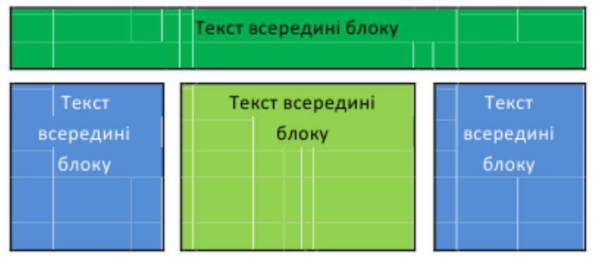

|2
a|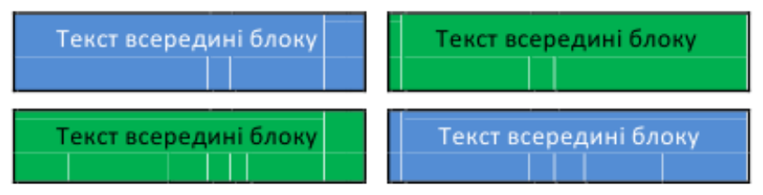

|3
a|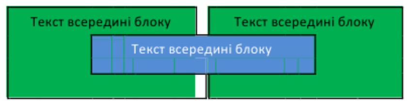

|4
a|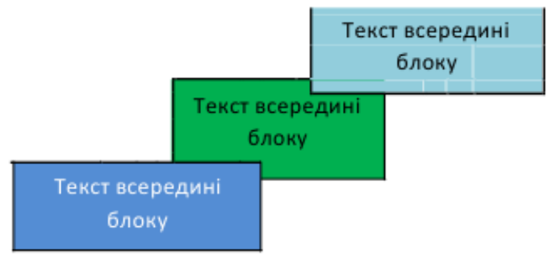

|5
a|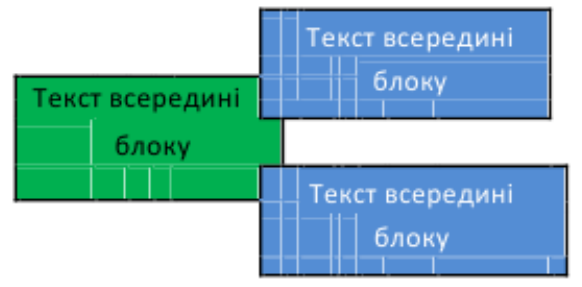

|6
a|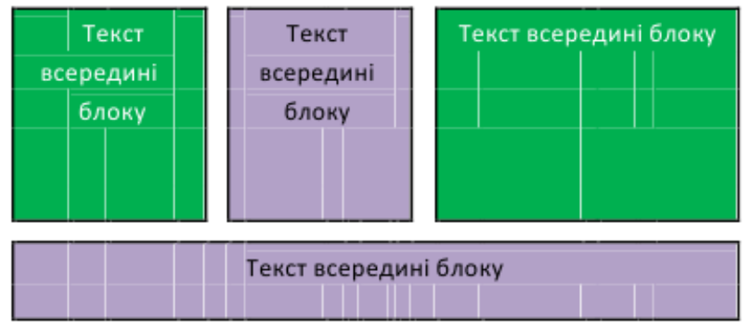

|7
a|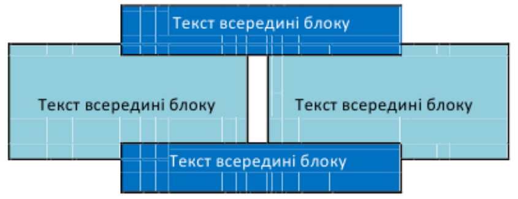

|8
a|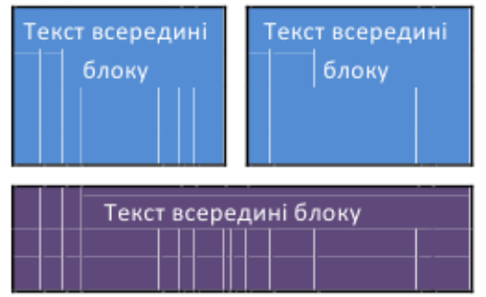

|9
a|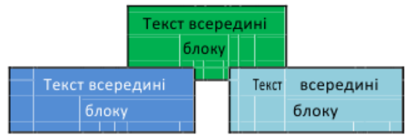

|10
a|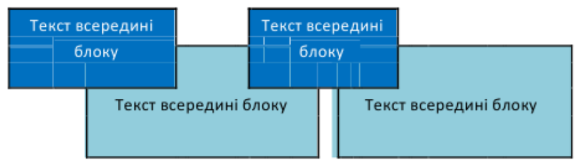

|11
a|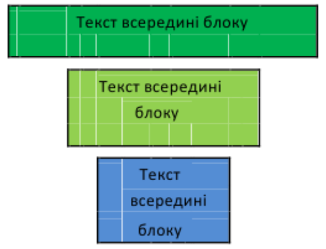

|12
a|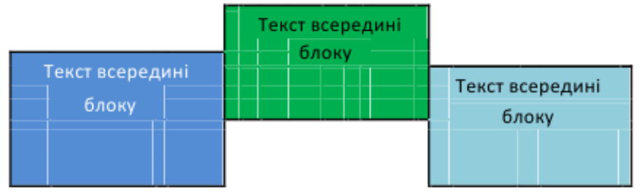

|13
a|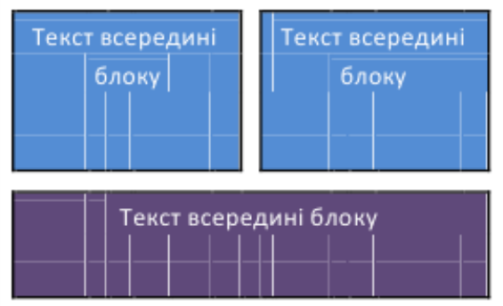

|14
a|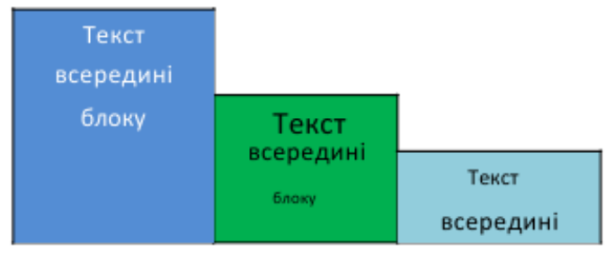

|15
a|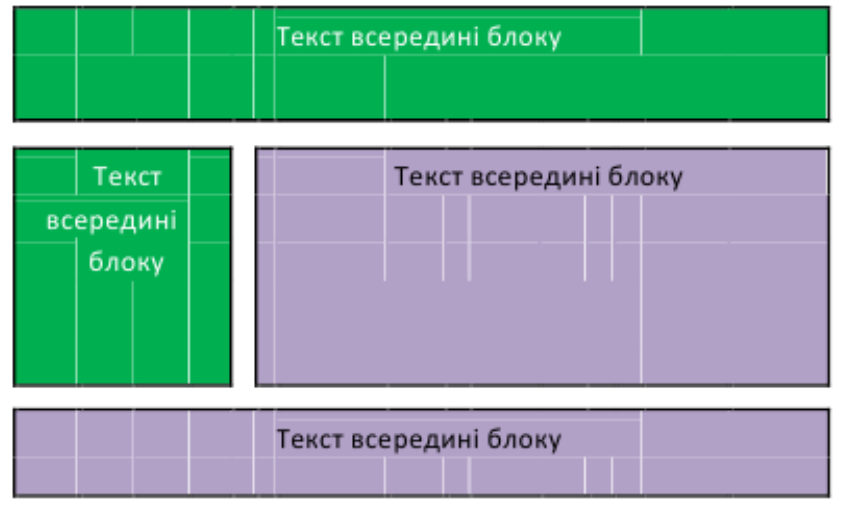

|16
a|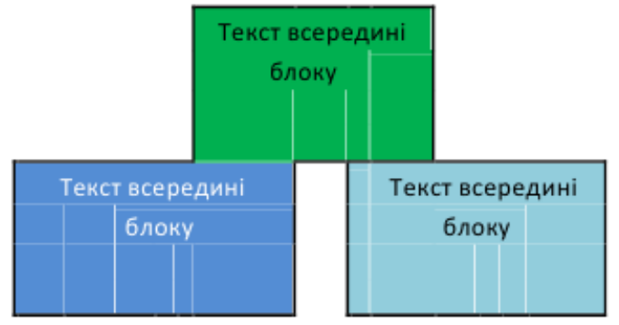

|17
a|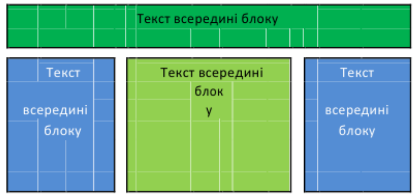

|18
a|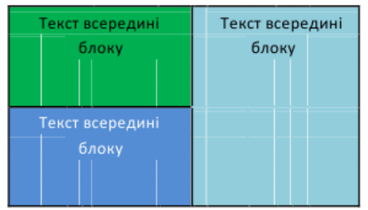

|19
a|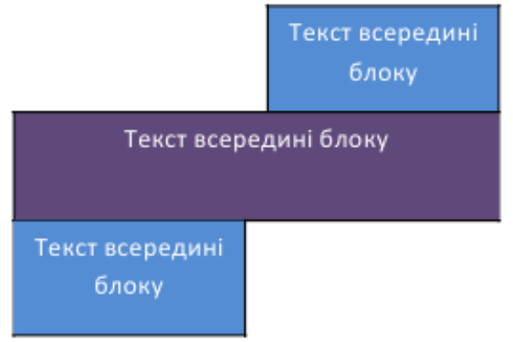

|20
a|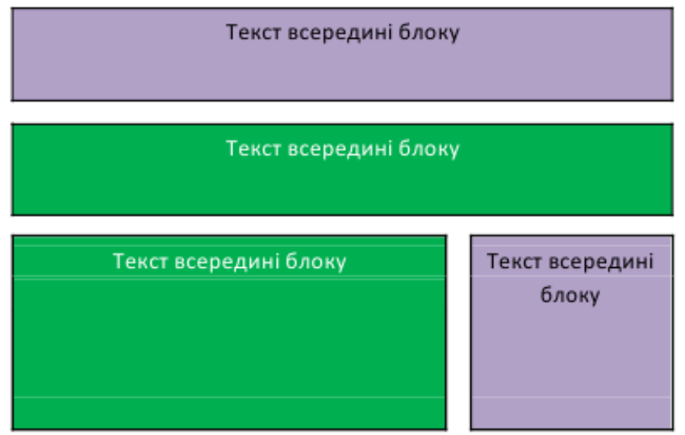
|===

=== Завдання 2

Відповідно до свого варіанта створіть HTML-документ та за допомогою CSS реалізуйте поставлене завдання.

NOTE: Для того, щоб відстежити поведінку курсору над певним елементом, використовуйте псевдоклас `:hover`.

TIP: Блок, що «з'являється», краще не прибирати з документа через `display: none`, а приховувати за допомогою `opacity: 0` або `visibility: hidden`.
Для зв'язку «наведення на один блок → поява іншого» використайте комбінатор сусіднього елемента, наприклад `.block-1:hover + .block-2`.

.Таблиця 2 - Завдання для самостійного виконання студентом
[cols="1,5,4",options="header"]
|===
|№ варіанта |Завдання |Пояснення

|1
a|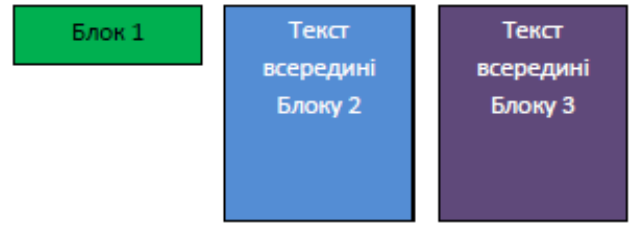
|Необхідно, щоби при наведенні на Блок 1 з'являвся Блок 2, а при наведенні на Блок 2 з'являвся Блок 3.

|2
a|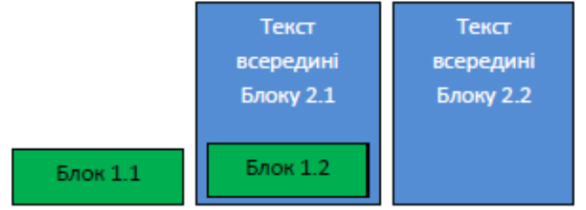
|Необхідно, щоби при наведенні на Блок 1.1 з'являвся Блок 2.1, а при наведенні на Блок 1.2 з'являвся Блок 2.2.

|3
a|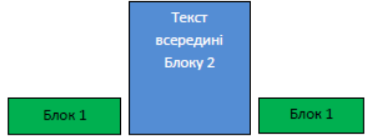
|Необхідно, щоби при наведенні на Блок 1 (той, що зліва) з'являвся Блок 2, а при наведенні на Блок 1 (той, що справа) зникав Блок 1 (той, що зліва).

|4
a|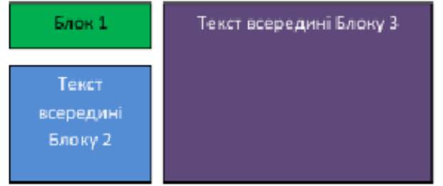
|Необхідно, щоби при наведенні на Блок 1 з'являвся Блок 2, а при наведенні на Блок 2 з'являвся Блок 3.

|5
a|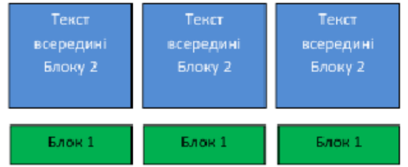
|Необхідно, щоби при наведенні на Блок 1 (будь-який) з'являвся Блок 2, знаходячись над Блоком 1.

|6
a|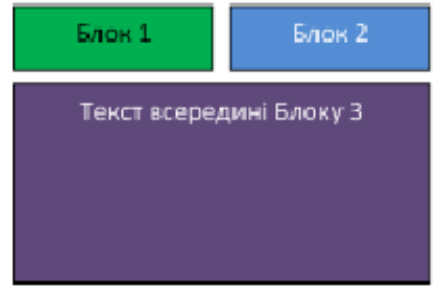
|Необхідно, щоби при наведенні на Блок 1 з'являвся Блок 2, а при наведенні на Блок 2 з'являвся Блок 3.

|7
a|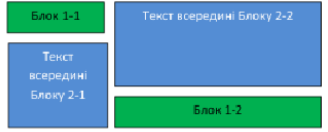
|Необхідно, щоби при наведенні на Блок 1.1 з'являвся Блок 2.1, а при наведенні на Блок 1.2 з'являвся Блок 2.2.

|8
a|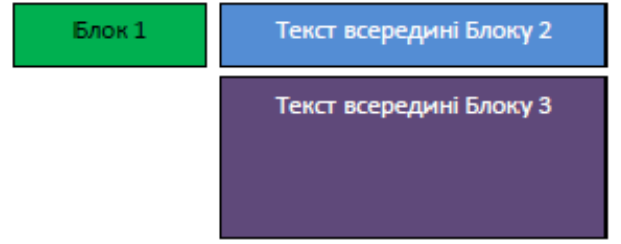
|Необхідно, щоби при наведенні на Блок 1 з'являвся Блок 2, а при наведенні на Блок 2 з'являвся Блок 3.

|9
a|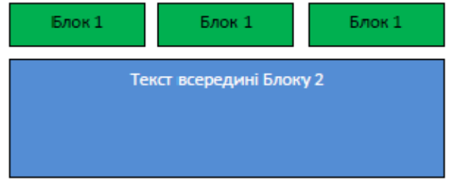
|Необхідно, щоби при наведенні на Блок 1 (будь-який) з'являвся Блок 2.

|10
a|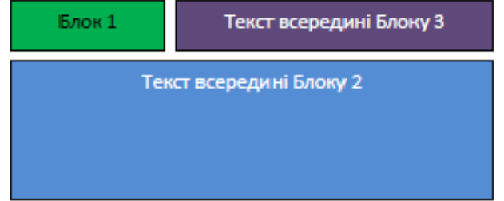
|Необхідно, щоби при наведенні на Блок 1 з'являвся Блок 2, а при наведенні на Блок 2 з'являвся Блок 3.

|11
a|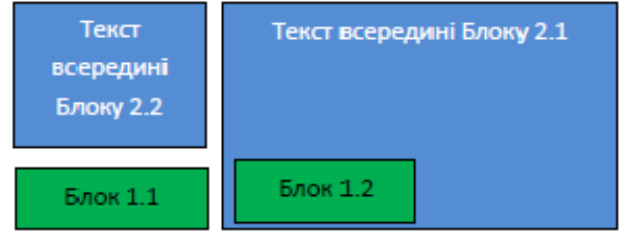
|Необхідно, щоби при наведенні на Блок 1.1 з'являвся Блок 2.1, а при наведенні на Блок 1.2 з'являвся Блок 2.2.

|12
a|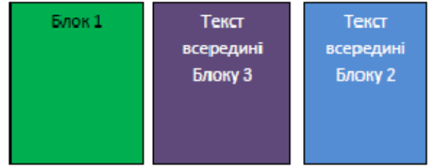
|Необхідно, щоби при наведенні на Блок 1 з'являвся Блок 2, а при наведенні на Блок 2 з'являвся Блок 3.

|13
a|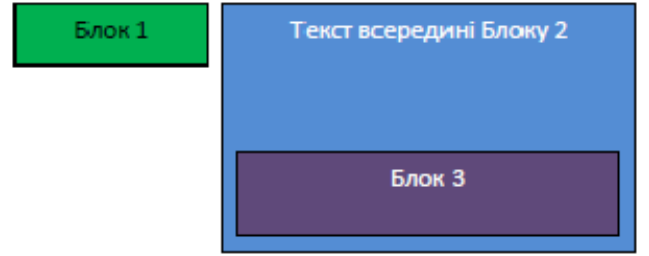
|Необхідно, щоби при наведенні на Блок 1 з'являвся Блок 2, а при наведенні на Блок 2 з'являвся Блок 3.

|14
a|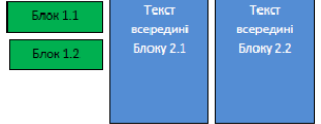
|Необхідно, щоби при наведенні на Блок 1.1 з'являвся Блок 2.1, а при наведенні на Блок 1.2 з'являвся Блок 2.2.

|15
a|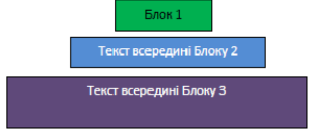
|Необхідно, щоби при наведенні на Блок 1 з'являвся Блок 2, а при наведенні на Блок 2 з'являвся Блок 3.

|16
a|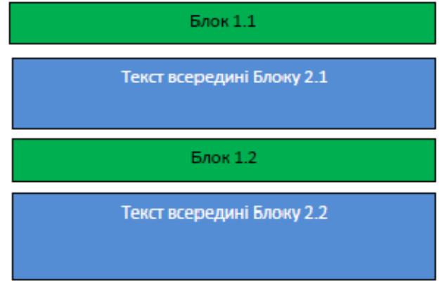
|Необхідно, щоби при наведенні на Блок 1.1 з'являвся Блок 2.1, а при наведенні на Блок 1.2 з'являвся Блок 2.2.

|17
a|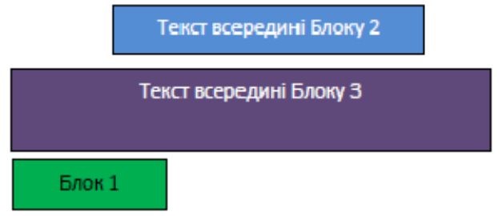
|Необхідно, щоби при наведенні на Блок 1 з'являвся Блок 2, а при наведенні на Блок 2 з'являвся Блок 3.

|18
a|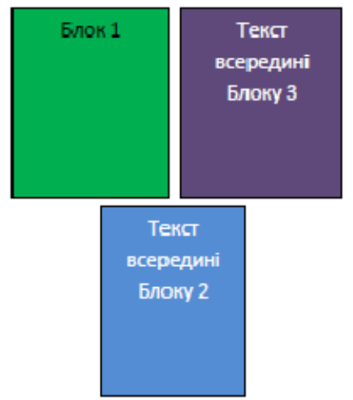
|Необхідно, щоби при наведенні на Блок 1 з'являвся Блок 2, а при наведенні на Блок 2 з'являвся Блок 3.

|19
a|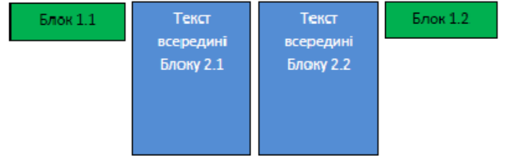
|Необхідно, щоби при наведенні на Блок 1.1 з'являвся Блок 2.1, а при наведенні на Блок 1.2 з'являвся Блок 2.2.

|20
a|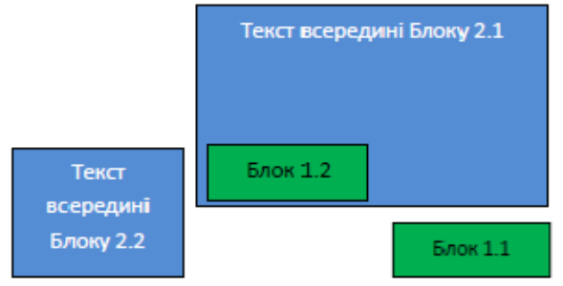
|Необхідно, щоби при наведенні на Блок 1.1 з'являвся Блок 2.1, а при наведенні на Блок 1.2 з'являвся Блок 2.2.
|===

=== Завдання 3

Реалізувати форму реєстрації на курс, зовнішній вигляд якої описано нижче, через застосування псевдокласів та псевдоелементів.
Створити HTML-файл `lab6-3.html` та таблицю стилів `style.css`.
Елементи стилізувати за класами.

.Орієнтовний макет форми
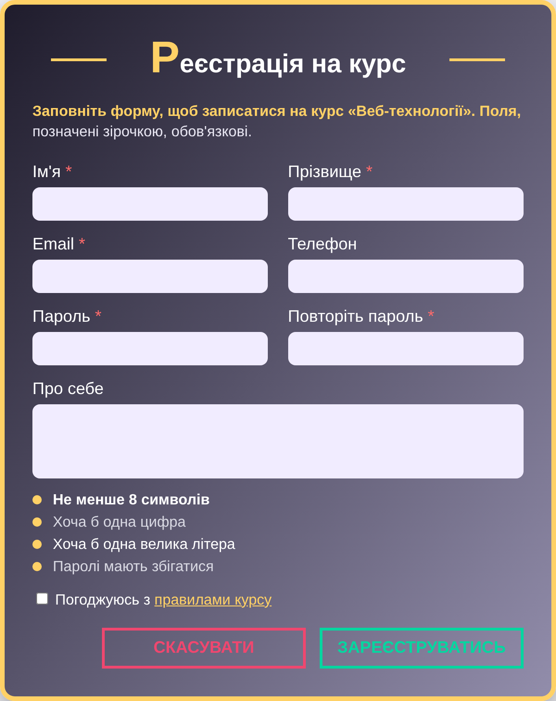

.Рекомендована HTML-структура (класи можна змінювати)
[source,html]
----
<form class="form">
    <h1 class="form-title">Реєстрація на курс</h1>
    
Заповніть форму, щоб записатися на курс ...

    <!-- 6 груп: Ім'я, Прізвище, Email, Телефон, Пароль, Повторіть пароль -->
    

        

            <label class="form-label form-label--required" for="firstname">Ім'я</label>
            <input class="form-input" type="text" id="firstname">
        

        <!-- ... -->
        

            <label class="form-label form-label--required" for="password">Пароль</label>
            <input class="form-input form-input--password" type="password" id="password">
        

        <!-- ... -->
    

    

        <label class="form-label" for="about">Про себе</label>
        <textarea class="form-textarea" id="about"></textarea>
    

    <ul class="form-hints">
        <li>Не менше 8 символів</li>
        <li>Хоча б одна цифра</li>
        <li>Хоча б одна велика літера</li>
        <li>Паролі мають збігатися</li>
    </ul>

    

        <input type="checkbox" id="agree">
        <label for="agree">Погоджуюсь з <a class="rules-link" href="#">правилами курсу</a></label>
    

    

        <button class="btn btn-reset" type="reset">Скасувати</button>
        <button class="btn btn-submit" type="submit">Зареєструватись</button>
    

</form>
----

==== Текст

* Шрифт: сімейство - `Arial, "Helvetica Neue", Helvetica, sans-serif`.
* Колір:
** `label`, заголовок форми, вступний текст - white;
** `input`, `textarea` - `#222`.
* Розмір кегля:
** `label`, `button` - `18px`;
** `input`, `textarea` - `16px`.

==== Форма

* Ширина форми - `600px`, розташування по центру сторінки, `box-sizing: border-box`.
* Внутрішні відступи - `30px` з усіх сторін.
* Границя - `5px solid #ffd166`, заокруглення кутів - `16px`.
* Задній фон - лінійний градієнт `linear-gradient(to bottom right, #1f1c2c, #928dab)`.
* Тінь - `box-shadow: 0 10px 30px rgba(0, 0, 0, 0.4)`.

==== Заголовок та вступний текст

* Заголовок: розташування тексту - по центру, розмір кегля - `28px`, насиченість шрифту - `700`, зовнішній відступ знизу - `20px`.
* Вступний текст: розмір кегля - `16px`, колір - `#e8e6f2`, зовнішній відступ знизу - `20px`.

==== Елементи форми

* Поля для введення тексту, пошти, телефону та пароля:
** ширина - `100%` від ширини групи, висота - `36px`, внутрішні відступи - `0 10px`;
** насиченість шрифту - `700`, заокруглення кутів - `8px`, колір фону - `#f1ecff`;
** відсутність границі, крім нижньої: `border-bottom: 4px solid transparent` (її колір змінюватиметься при `:hover` та `:focus`).
* Поле для введення багаторядкового тексту:
** ширина - `100%`, висота - `80px`, заборона зміни розмірів елемента (`resize: none`), внутрішні відступи - `5px`;
** заокруглення кутів - `8px`, відсутність границі.
* Розташування полів у два стовпці реалізувати через `float` у поєднанні з псевдоелементом `:after` (clearfix), доданим до батьківського елемента `.form-fields`:
+
[source,css]
----
.form-fields:after {
    display: block;
    content: '';
    clear: both;
}
----

* Кожна група `.form-group` у контейнері `.form-fields`: `float: left`, ширина - `48%`, зовнішній відступ знизу - `15px`.

==== Кнопки

* Ширина - `150px`, висота - `44px`, шрифт - жирний, у верхньому регістрі, форма курсора при наведенні - `pointer`, фон - прозорий.
* Кнопки розташувати по правому краю (`text-align: right` у `.form-buttons`).
* Кольори:
** кнопка для скасування - `border: 3px solid #ef476f`, text: `#ef476f`;
** кнопка для відправки - `border: 3px solid #06d6a0`, text: `#06d6a0`.

==== Значення елементів форми при використанні псевдокласів

[cols="3,3,3,3",options="header"]
|===
|Елемент |:hover |:focus |:active

|Поля для введення тексту, пошти та телефону
|нижня внутрішня границя - `4px`, колір - `#ffd166`
|нижня внутрішня границя - `4px`, колір - `#06d6a0`, колір фону - `#ffffff`
|

|Поле для введення пароля
|нижня внутрішня границя - `4px`, колір - `#ff9f1c`
|нижня внутрішня границя - `4px`, колір - `#00b4d8`, колір фону - `#ffffff`
|

|Поле для введення багаторядкового тексту
|тінь елемента: радіус розмиття - `10px`, розтягнення - `5px`, колір - `rgba(255, 209, 102, 0.6)`
|тінь елемента: радіус розмиття - `10px`, розтягнення - `5px`, колір - `rgba(6, 214, 160, 0.6)`
|

|Кнопка для відправки
|`border: 3px solid #06d6a0`, text: white, `background-color: #06d6a0`, `border-radius: 15px`
|`outline: 3px dashed #ffd166`
|`border: 3px solid #ffd166`, `background-color: #04785a`, `border-radius: 25px`, `position: relative`, `top: 2px`

|Кнопка для скасування
|`border: 3px solid #ef476f`, text: white, `background-color: #ef476f`, `border-radius: 15px`
|`outline: 3px dashed #ffd166`
|`border: 3px solid #ffd166`, `background-color: #a8203d`, `border-radius: 25px`, `position: relative`, `top: 2px`

|Посилання «правилами курсу»
|колір - white, підкреслення
|
|колір - `#ef476f`
|===

Для посилання `.rules-link` додатково задати: звичайний колір - `#ffd166`, колір відвіданого посилання (`:visited`) - `#c9b6ff`.
Дотримуватись LVHA-порядку правил.

==== Застосування до елементів форми псевдокласів положення в коді

* Групи в контейнері `.form-fields`:
** `:nth-child(odd)` - зовнішній відступ справа - `4%`;
** `:nth-child(even)` - зовнішній відступ справа - `0`.
* Список вимог до пароля `.form-hints`:
** `li:first-child` - насиченість шрифту - `700`;
** `li:last-child` - зовнішній відступ знизу - `0`;
** `li:nth-child(odd)` - колір тексту - white, `li:nth-child(even)` - колір тексту - `#d9d9e3`.
* Кнопки: `.btn:last-child` - зовнішній відступ зліва - `15px`.

==== Застосування до елементів форми псевдоелементів

* Вступний текст (`.form-intro`):
** `:first-line` - колір тексту - `#ffd166`, насиченість шрифту - `700`.
* Заголовок форми (`.form-title`, `position: relative`):
** `:first-letter` - розмір кегля - `48px`, колір тексту - `#ffd166`;
** `:before` та `:after` в поєднанні з `position: absolute` - для додавання ліній ліворуч та праворуч від тексту заголовка (`width: 60px`, `height: 3px`, колір - `#ffd166`, розташування по вертикалі - по центру заголовка).
* Підписи обов'язкових полів (`.form-label--required`):
** `:after` - додає після тексту `content: ' *'` червоного кольору (`#ff6b6b`).
* Елементи списку вимог до пароля (`.form-hints li`):
** `:before` - додає маркер без застосування зображень: `content: ''`, `display: inline-block`, `width: 10px`, `height: 10px`, `border-radius: 50%`, `background-color: #ffd166`, `margin-right: 12px`.
* Кнопки (`<button>`):
** комбінація псевдокласу `:active` із псевдоелементом `:after` для відображення піктограми: `content: ' ✔'` для кнопки відправки та `content: ' ✖'` для кнопки скасування.

==== Комбінація псевдокласів із псевдоелементами

* `.form-title:hover:before` та `.form-title:hover:after` - лінії біля заголовка подовжуються до `90px` та змінюють колір на `#06d6a0`.
* `.form-hints li:hover:before` - колір маркера змінюється на `#06d6a0`.

TIP: Додатково (за бажанням, самостійно) можна використати псевдокласи `:checked`, `:disabled` та псевдоелементи `:placeholder`, `:selection`, яких немає в теоретичній частині цієї роботи.

=== Завдання 4

Реалізувати навігаційні панелі (горизонтальну та вертикальну) із випадними пунктами меню.

Використати багаторівневі марковані списки, елементами яких будуть посилання.
Колір, шрифт, розміри та інші властивості підібрати самостійно.

У даному завданні необхідно використовувати властивості, що пов'язані з позиціонуванням.

Передбачити:

* Для обох панелей навігації:
** відображення активного (поточного) пункту меню;
** при наведенні на пункти меню вигляд навігації змінюється (`:hover`).
* Для горизонтальної навігаційної панелі:
** перший рівень навігації повинен бути представлений піктограмами (панель значків), піктограми - https://fonts.google.com/icons[Google Fonts Icons];
+
.Приклад горизонтальної панелі
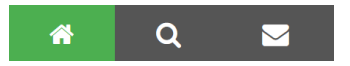

** фіксацію (`fixed`-позиціонування) панелі навігації у верхній частині сторінки;
** вирівнювання останнього пункту меню справа сторінки через використання плаваючих елементів (`float`);
** створення (`sticky`) «липкої» навігаційної панелі меню.
* Для вертикальної навігаційної панелі:
** перший рівень навігації повинен бути представлений піктограмами (панель значків), піктограми - https://fonts.google.com/icons[Google Fonts Icons], та назвою пункту меню;
+
.Приклад вертикальної панелі
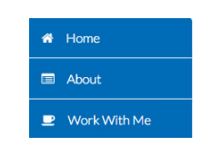

** повна висота фіксованої вертикальної навігації;
** передбачити три рівні вкладеності.

=== Завдання 5

Реалізувати HTML-сторінку за прикладом.
Використовуючи CSS-властивості для роботи з тінню, прозорістю та відображенням елементів.

.Приклад сторінки
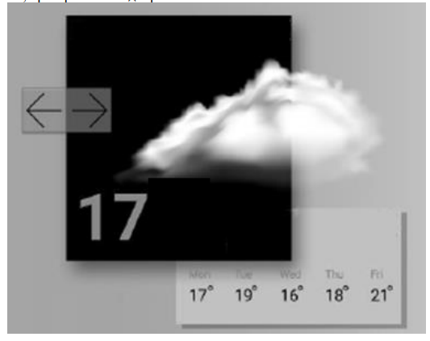

TIP: Для виконання завдання знадобляться властивості `box-shadow`, `opacity`, `display` / `visibility`, а також `position` та `z-index` для накладання елементів один на одного.

=== Завдання 6

Реалізувати попап (спливаюче вікно) засобами HTML та CSS.
Створити HTML-файл `lab6-6.html` та таблицю стилів `style.css`.

==== Вимоги

. Ніякого JavaScript, лише HTML/CSS, дозволено використання препроцесорів.
. Ніяких зовнішніх бібліотек чи фреймворків.
. Підтримка веббраузера: лише Chrome.
. Очікується, що попап матиме три стани залежно від дій користувача:
** початковий стан: попап не видно;
** після натискання на кнопку `popup-button` попап стає видимим або прихованим, якщо він уже відкритий;
** після натискання кнопки «More» додається ще від 3 до 10 іконок, і вміст попапу стає доступним для прокручування.
. Стилізувати елементи за класами (а не за тегами HTML та ідентифікаторами).
. Усі інтерактивні елементи мають бути позначені як такі при наведенні (hover) миші.
. Усі інтерактивні елементи повинні мати стан `:focus`.
. Для взаємодії з попапом з клавіатури застосувати атрибут `tabindex`:
** кнопка `popup-button`, кнопка «More» та кожен інтерактивний елемент усередині попапу мають бути досяжними клавішею kbd:[Tab] у логічному порядку (для елементів, які за замовчуванням не отримують фокус, задати `tabindex="0"`);
** коли попап закритий, його вміст не повинен потрапляти в порядок табуляції: приховувати попап слід за допомогою `visibility: hidden` або `display: none`, а не лише `opacity: 0`;
** контейнер попапу в прокручуваному стані повинен отримувати фокус (`tabindex="0"`), щоб його вміст можна було прокручувати з клавіатури стрілками;
** використання додатних значень `tabindex` (більше `0`) заборонено.

NOTE: Оскільки JavaScript використовувати не можна, перемикання станів реалізується через HTML/CSS: наприклад, за допомогою прихованих `input type="checkbox"` та `label` у поєднанні з псевдокласом `:checked` і комбінаторами `+` / `~`, або за допомогою `:focus` / `:focus-within`.
Якщо використовується прихований `checkbox`, ховайте його так, щоб він залишався фокусованим (наприклад, `position: absolute; opacity: 0;`), а не через `display: none`, інакше керування з клавіатури буде неможливим.

.Початковий стан: попап не видимий
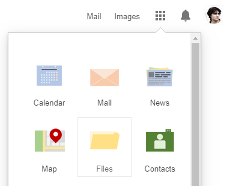

.Активний стан
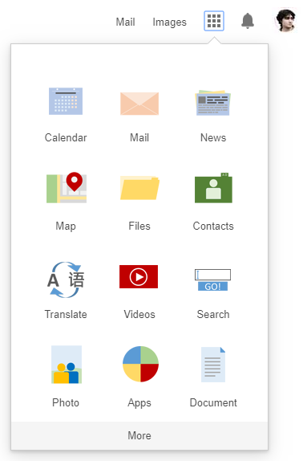

.Розширений набір іконок, scrollable стан
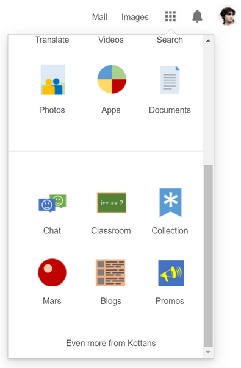

.Усі інтерактивні елементи мають бути позначені як такі при наведенні (hover) миші

.Усі інтерактивні елементи повинні мати стан `:focus`
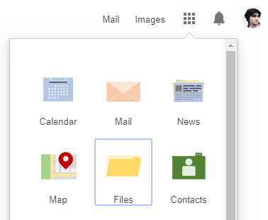

<<<

== Контрольні питання

. Чим відрізняються `opacity: 0`, `visibility: hidden` та `display: none`?
У яких випадках з елементом можна взаємодіяти і чи зберігається за ним місце на сторінці?
. Які значення приймає властивість `position`?
Як кожне з них впливає на положення елемента та на його місце в потоці документа?
. Як працює `position: relative`?
Відносно чого змінюється положення елемента та що відбудеться, якщо одночасно задати `left` і `right`?
. Чому для `position: absolute` важливо, щоб у елемента-батька було задано `position: relative`?
Що станеться, якщо такого батька немає?
. Чим `position: fixed` відрізняється від `position: absolute`?
Для яких елементів сторінки його зазвичай використовують?
. Як працює `position: sticky`?
Які властивості потрібні для його роботи та в який момент елемент «прилипає» та перестає бути «липким»?
. Для яких значень `position` працює `z-index`?
Яке значення за замовчуванням і що відбудеться, якщо в двох елементів значення однакові?
. Що таке псевдоклас?
Який синтаксис його запису та чим псевдоклас відрізняється від звичайного класу?
. Коли спрацьовують псевдокласи `:hover`, `:active`, `:focus` та `:visited`?
До яких елементів вони найчастіше застосовуються?
. Що таке LVHA-порядок?
Чому порядок запису псевдокласів для посилань важливий і що станеться, якщо його порушити?
. Чим відрізняються псевдокласи `:first-child`, `:last-child` та `:nth-child()`?
З якого числа починається нумерація?
. Які елементи будуть вибрані за допомогою `:nth-child(odd)`, `:nth-child(even)` та `:nth-child(3n+3)`?
. Що таке псевдоелемент?
Чим відрізняється синтаксис псевдоелементів (`:`) від синтаксису псевдокласів (`:`)?
Які псевдоелементи ви знаєте?
. Для чого потрібна властивість `content` у `:before` та `:after`?
Чому без неї псевдоелементи не відображаються і чому вони не працюють з тегом `<input>`?
. Що робить атрибут `tabindex` та чим відрізняються значення `0`, `-1` і додатні числа?
Яким чином `tabindex` допомагає організувати взаємодію з попапом без JavaScript?
