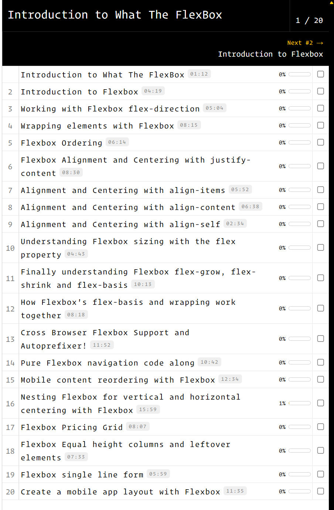
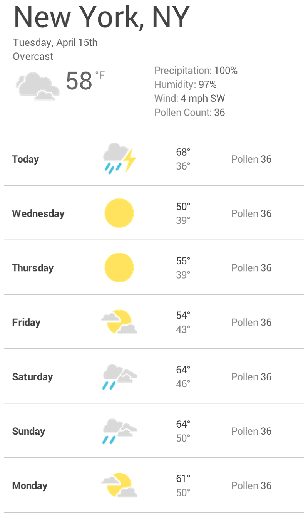

= ЛАБОРАТОРНА РОБОТА №7

*Тема: Робота з Flexbox в CSS.
Основи адаптивної верстки: використання media-запитів.*

*Мета: Ознайомитися з принципами роботи моделі розташування елементів Flexbox у CSS, навчитися створювати гнучкі та зручні у використанні макети вебсторінок.
Закріпити навички побудови адаптивної верстки за допомогою media-запитів, що забезпечують коректне відображення інтерфейсу на пристроях із різною роздільною здатністю екрана*

*Вимоги до звіту:*

. Для всіх завдань використовувати скидання стилів (reset або normalize).
. Додати шрифти до завдань з https://fonts.google.com/[Google Fonts].
. Використати https://developer.mozilla.org/en-US/docs/Web/CSS/var[CSS variables]
. Дотримуватись правил написання html, css.
. Заборонено використання сторонніх UI бібліотек.
. Результати завдань лабораторної роботи повинні бути завантажені до особистого репозиторію студента.

== Самостійна робота:

** https://developer.mozilla.org/en-US/docs/Web/CSS/CSS_flexible_box_layout/Basic_concepts_of_flexbox[Basic concepts of flexbox]
** https://css-tricks.com/snippets/css/a-guide-to-flexbox/[CSS Flexbox Layout Guide]
** https://developer.mozilla.org/en-US/docs/Web/CSS/CSS_media_queries/Using_media_queries[Using media queries]
** https://css-tricks.com/a-complete-guide-to-css-media-queries/[CSS Media Queries Guide]
** https://blog.ithillel.ua/articles/the-complete-guide-to-flexbox[Повний посібник з Flexbox + Using media queries]

== Практична частина

=== Завдання 1

Пройти інтерактивну гру https://flexboxfroggy.com/[Flexbox Froggy].
Результат виконання додати у вигляді print screen у репозиторії.

=== Завдання 2

Зареєструватися та пройти курс https://flexbox.io[What The Flexbox?!].
Результат з прогресом виконання додати у вигляді print screen у репозиторії.
Повторити код усіх уроків та представити у репозиторії.

=== Завдання 3

Відтворити приклад макета додатку погоди на n-кількість днів, на базі гнучкої FLEX розмітки (використавши різні іконки з директорії *icons*).

=== Завдання 4

Дане завдання слід виконувати у `НОВОМУ` репозиторію з назвою `landing-keepsake`

Необхідно зверстати адаптивний односторінковий лендінг дизайн-агенції Keepsake за макетом у Figma.

Макет https://www.figma.com/design/ZMpmNEBMsLPHJF7GyoHu2f[Keepsake - Responsive у Figma]

Фрейми макета - `Desktop - 1280`, `Tablet - 768`, `Mobile - 375`, `Mobile - menu open`, `UI states`

Додати `README.md` з посиланням на демо та коротким описом рішень та технологій, які були використані під час виконання даного завдання.

==== Технічні вимоги

Верстка виконується суто з використанням HTML та CSS.
Фреймворки та UI-бібліотеки (Bootstrap, Tailwind) *заборонені*.

[cols="1,4",options="header"]
|===
| Вимога | Деталі

| HTML
| Семантичний HTML5: `header`, `nav`, `main`, `section`, `article`, `footer`, `form`.
Один `h1` на сторінку, правильна ієрархія заголовків.

| CSS
| Кольори, шрифти й відступи винесені в CSS-змінні (`:root`).
Розкладка на Flexbox і без абсолютного позиціонування для сітки.

| Підхід
| Mobile first: базові стилі для 375, далі `@media (min-width: ...)`.

| Шрифти
| Oswald (300, 400, 700), Open Sans (300, 400, 700), Dancing Script 700 - з Google Fonts або локально у WOFF2.

| Іконки
| Інлайн-SVG.

| Браузери
| Останні 2 версії Chrome, Firefox, Edge;

| Валідність
| HTML без помилок у https://validator.w3.org/[W3C Validator].
|===

.Рекомендована структура проєкту
----
landing-keepsake/
├── index.html
├── css/
├── images/
└── fonts/
----

== Дизайн-токени

Усі значення нижче оголосити як CSS-змінні в `:root` і використовувати лише через них.
Точні значення звіряйте з макетом через Dev Mode або Inspect у Figma.

=== Кольори

[cols="2,1,4",options="header"]
|===
| Змінна | Значення | Де використовується

| `--color-accent` | `#F95858` | Кнопки, активний пункт меню, акцентні риски, посилання
| `--color-accent-hover` | `#E44646` | Ховер основної кнопки
| `--color-teal` | `#2CD5C4` | Кнопка «+» на ховері карточки, категорія, стани focus і success форми
| `--color-text-dark` | `#3A3A3C` | Заголовки, навігація
| `--color-text` | `#666A6E` | Основний текст
| `--color-muted` | `#9AA0A6` | Підписи, лейбли статистики
| `--color-bg-light` | `#F0F3F4` | Hero, відгук, фон іконок послуг
| `--color-border` | `#E1E5E8` | Бордери чипсів і роздільники
| `--color-footer` | `#2A2A2D` | Фон футера
| `--color-overlay` | `rgba(30, 32, 36, .82)` | Оверлей карточки на ховері
|===

=== Типографіка

[cols="2,2,2,4",options="header"]
|===
| Роль | Шрифт | Розмір 1280 / 768 / 375, px | Особливості

| Заголовок hero (`h1`) | Oswald Light | 40 / 32 / 26 | Uppercase, letter-spacing 3px, line-height 1.25
| Заголовок CTA | Oswald Light | 28 / 24 / 22 | Uppercase, letter-spacing 3px
| Заголовок секції (`h2`) | Oswald Regular | 18 | Uppercase, letter-spacing 1.5px, коралова риска 16×2 праворуч
| Навігація, кнопки, чипси | Oswald Regular | 13 / 13 / 12 | Uppercase, letter-spacing 1px
| Основний текст | Open Sans Regular | 14 | line-height 22px
| Текст відгуку | Open Sans Light | 22 / 19 / 16 | line-height 1.6
| Цифри статистики | Oswald Light | 48 / 40 / 38 | -
| Логотип | Dancing Script Bold | 26 / 26 / 22 | Літера «K» у темному колі 40 / 40 / 34
|===

=== Відступи та форми

* Вертикальний відступ між секціями: *90 / 72 / 56 px*.
* Бокові поля контейнера: *90 / 40 / 20 px*.
* Заокруглень у дизайні немає, крім круглих елементів (іконки, аватари, соцмережі, кнопка «вгору»).

== Брейкпоінти та сітка

[cols="1,1,1,1,3",options="header"]
|===
| Брейкпоінт | Ширина в макеті | Медіазапит | Поля | Ключові зміни

| Mobile | 375 | базові стилі (від 320) | 20 | Бургер-меню, все в 1 колонку
| Tablet | 768 | `min-width: 768px` | 40 | Навігація в рядок, роботи у 2 колонки, послуги 2×2
| Desktop | 1280 | `min-width: 1280px` | 90 | Роботи 3×3, послуги в рядок, журнал у 2 колонки
|===

[IMPORTANT]
====
* Сторінка коректна на будь-якій ширині від *320 до 1920 px*, а не лише в контрольних точках.
* Горизонтального скролу сторінки бути не повинно (виняток - рядок чипсів на мобайлі, див. нижче).
* На ширині понад 1280 контент центрується, максимальна ширина контейнера - *1100 px*.
====

== Секції сторінки

Для кожної секції вказано поведінку на кожному брейкпоінті.
Деталі розмірів беріть із відповідного фрейму в Figma.

=== Header

[cols="1,3",options="header"]
|===
| Брейкпоінт | Поведінка

| Desktop
| Логотип ліворуч, праворуч навігація з 5 пунктів і коралова кнопка «Favourites» 36×36 із серцем.
Активний пункт - коралового кольору.

| Tablet
| Та сама структура з меншим проміжком між пунктами (24).

| Mobile
| Логотип зменшений, праворуч кнопка-бургер для відкриття меню 40×40.
|===

=== Hero

Сірий блок (`--color-bg-light`) із заголовком `h1`, підзаголовком і двома кнопками: «See our works» (основна) та «Get in touch» (другорядна).
На мобайлі кнопки розтягуються на всю ширину й стоять одна під одною.

=== Our awesome works (портфоліо)

* Заголовок секції та рядок чипсів-фільтрів: All, Branding, Identity, Print, Web, Motion.
* Сітка карточок через CSS Grid:
** Desktop - 3 колонки, 9 карточок, gap 14;
** Tablet - 2 колонки, 8 карточок, gap 12;
** Mobile - 1 колонка, 5 карточок, gap 12.
* Пропорція карточки - приблизно 1 : 0.79 (на мобайлі 1 : 0.72); тримати через `aspect-ratio`.
* Під сіткою - другорядна кнопка «Load more works» (на мобайлі на всю ширину).
* На мобайлі чипси не переносяться, а прокручуються горизонтально; рядок «виходить» за правий край екрана.

=== CTA

Центрований заголовок «Would you love to work with us?» і кнопка «Contact us» з іконкою конверта.

=== What do we do (послуги)

Чотири послуги: круглий фон з іконкою, назва, опис по центру.
Desktop - 4 в рядок; Tablet і Mobile - 2×2 (на мобайлі іконка 72 замість 96).

=== Статистика

Чотири показники (число + підпис) між тонкими роздільниками зверху та знизу.
Desktop і Tablet - 4 в рядок; Mobile - 2×2.

=== Clients & kind words

* Логотипи клієнтів: Desktop - 6 в рядок, Tablet - 3×2, Mobile - 2×3.
* Нижче - блок відгуку на сірому фоні: коралові лапки, текст, аватар з ініціалами, ім'я та посада, індикатор слайдера (3 точки).

=== From the journal

Чотири записи: квадратне прев'ю, мета (дата / категорія), заголовок, анонс, посилання «Read more».
Desktop - 2 колонки (прев'ю 150); Tablet - 1 колонка (прев'ю 150); Mobile - 1 колонка (прев'ю 96).

=== Footer

[cols="1,3",options="header"]
|===
| Брейкпоінт | Поведінка

| Desktop/Tablet
| Верхня частина: ліворуч дві колонки посилань (Studio, Services), праворуч форма підписки.
Під роздільником: копірайт ліворуч, соцмережі праворуч.

| Mobile
| Спочатку форма підписки (поле й кнопка одне під одним), під нею дві колонки посилань.
Унизу соцмережі й копірайт по центру.
|===

== Інтерактивність і стани

Усі стани показані у фреймі `UI states` в Figma.

=== Мобільне меню (без використання js)

* Бургер відкриває випадаюче меню (фрейм `Mobile - menu open`); у відкритому стані бургер стає хрестиком.
* У меню: 5 пунктів із роздільниками, кнопки «Contact us» і «Favourites», знизу блок контактів і соцмережі.
* Меню закривається хрестиком.

=== Карточка роботи - ховер

Однаковий для всіх карточок: темний оверлей, бірюзове коло з «+», назва роботи, коралова лінія, категорія.
Той самий стан має вмикатися під час фокусу з клавіатури (`:focus-visible` / `:focus-within`).

=== Інші стани

[cols="1,3",options="header"]
|===
| Елемент | Стани

| Кнопки | default, hover (темніший корал), focus-visible (видимий контур)
| Чипси | default, hover (кораловий бордер і текст), active (кораловий фон)
| Пункти навігації | default, hover, active
| Посилання у футері | default, hover (білий колір)
|===

=== Фільтр портфоліо (релізувати через :checked ~)

Клік по чипсу робить його активним і показує лише карточки з відповідною категорією (атрибут `data-category`).
«All» показує всі карточки.

=== Форма підписки

* Стани: default, focus (бірюзовий бордер), error (кораловий бордер + текст помилки), success (повідомлення замість полів).
* HTML валідація email, прапорець згоди обов'язковий.
* Реальна відправка не потрібна.

=== Fixed header і кнопка «вгору»

* Поведінка header при скролі - fixed
* Кнопка «вгору» присутня завжди (44×44, корал).

== Доступність і продуктивність

.Доступність
* Усі інтерактивні елементи доступні з клавіатури, фокус видно.
* Бургер - це `<button>` з `aria-expanded` і `aria-controls`; іконочні кнопки мають `aria-label`.
* У форми є `<label>` (можна візуально приховати), помилка пов'язана з полем через `aria-describedby`.
* Змістовні зображення мають `alt`, декоративні - `alt=""`.

.Продуктивність
* Зображення у WebP, з `width` / `height` і `loading="lazy"` (крім першого екрана).
* Шрифти з `font-display: swap`.

WARNING: Робота з використанням заборонених фреймворків або згенерована без розуміння коду (студент не може пояснити рішення на захисті) не зараховується.

=== Завдання 5

Кінцевий результат роботи створення адаптивної вебсторінки представити на https://docs.github.com/en/pages[GitHub Pages]

== Контрольні запитання

. Що таке flex-контейнер і flex-елементи?
Яка властивість створює flex-контекст і чим відрізняються значення `flex` та `inline-flex`?
. Поясніть поняття головної (main) і поперечної (cross) осей.
Як властивість `flex-direction` змінює їхній напрямок?
. Чим відрізняються `justify-content` і `align-items`?
Наведіть приклад, як відцентрувати елемент по горизонталі й вертикалі.
. Для чого потрібна властивість `flex-wrap`?
Що станеться з елементами, які не вміщуються в контейнер, якщо її не задати?
. Чим `align-content` відрізняється від `align-items` і за яких умов `align-content` взагалі має ефект?
. Поясніть призначення властивостей `flex-grow`, `flex-shrink` і `flex-basis`.
Що означає запис `flex: 1 1 200px`?
. Чим відрізняються записи `flex: 1` і `flex: auto`?
Як вони впливають на розподіл вільного простору?
. Для чого використовуються властивості `order` і `align-self`?
Які проблеми з доступністю може спричинити зміна візуального порядку через `order`?
. Як властивість `gap` працює у flex-контейнері і чому вона зручніша за `margin` для відступів між елементами?
. Що таке адаптивна верстка і чим вона відрізняється від гумової та фіксованої?
Яку роль відіграє метатег `<meta name="viewport">` і що станеться без нього на мобільному пристрої?
. Опишіть синтаксис media-запиту.
Які типи медіа (`screen`, `print`, `all`) і логічні оператори (`and`, кома, `not`, `only`) ви знаєте?
. Чим відрізняються підходи mobile first і desktop first?
Які умови (`min-width` чи `max-width`) характерні для кожного з них і чому mobile first вважають кращою практикою?
. Що таке брейкпоінти (контрольні точки)?
Як їх правильно обирати: за популярними пристроями чи за контентом?
Обґрунтуйте відповідь.
. Які media-функції, крім ширини, ви знаєте (`orientation`, `hover`, `prefers-color-scheme`, `prefers-reduced-motion`)?
Наведіть приклад практичного використання однієї з них.
. Як за допомогою Flexbox і media-запитів перебудувати рядок із трьох карточок на десктопі в одну колонку на мобільному?
Напишіть фрагмент CSS-коду.
